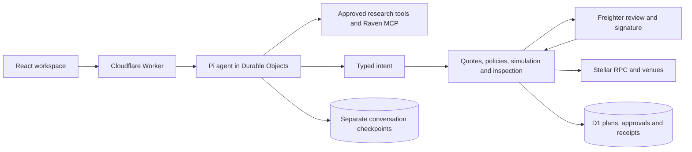

# Nest

Discovery, research, and wallet-approved execution across Stellar DeFi.

Nest combines sourced protocol research with an embedded Pi agent and a deterministic execution service. The agent can research and propose an action. Your wallet reviews and signs the exact transaction.

## What works

| Surface | Implemented behavior |
| --- | --- |
| Research | Dated DefiLlama/RWA.xyz observations, protocol details, filtering, charts, live Blend rates, and Aquarius liquidity discovery. Click or highlight an APY to open a typed lending command and reviewed Blend proposal; other questions carry the selection into Ask Nest. |
| Chat | Streamed Pi conversations, bounded research tools, Raven MCP authorization, and typed proposals. |
| Automations | Live XLM/USDC pool comparison, reviewed arbitrage monitors, one-minute checks, and deduplicated in-app alerts. Monitoring reads pool state and never executes trades. |
| Swap | Soroswap on mainnet; the Stellar DEX on Testnet. Debounced quotes, policy checks, transaction inspection, Freighter signing, and confirmation. The approved candlestick chart retains its captured reference series and full research-asset window; connected wallets expose spendable balances and recorded activity. Live Stellar history endpoints remain available separately. |
| Limit orders | A compact Aquarius XLM/USDC range-position ticket with reviewed placement and withdrawal. Wallet signatures and the adapter's execution gate remain required; automated price crossing does not submit another transaction. |
| Credit | Blend supply, collateralized borrowing, repay, withdrawal, and a separate USDC trustline step. Pool exclusions and withdrawal conditions remain visible. |
| Vaults | Live DeFindex vault reads and wallet-approved XLM/USDC deposits. Withdrawal execution and chat deposit proposals are not implemented. |
| Landing | Standalone introduction with dated metrics and a question form that fills an unsent chat draft. |

Additional venue integrations, saved wallet-authenticated history, generic background automations, strategy backtesting, and card spending are product targets or interface previews. They are not claims of working financial execution. See the [implementation specification](docs/technical-spec.md) for the target contracts and [architecture decisions](docs/architecture-decisions.md) for the current runtime.

## Architecture



`apps/web` is a Vite/React application using TanStack Router/Query and the shadcn components in `packages/ui`. `apps/worker` serves same-origin APIs, streams, the execution lifecycle, and D1 migrations. Domain identities, decimal amounts, policies, adapters, data validation, job claims, and the Pi bridge live in separate packages.

Financial state is application-owned. Conversation state cannot authorize an action, change a policy, or replace an on-chain receipt. Mainnet and Testnet have separate configuration and database bindings.

## Local setup

Use Node 24 and pnpm 12; the exact pnpm version is pinned in `package.json`.

```sh
corepack enable
pnpm install
cp .dev.vars.example apps/worker/.dev.vars
```

Edit the ignored variables file. Set `APP_ENCRYPTION_KEY` to a fresh 32-byte base64 value, generated with `openssl rand -base64 32`. Add an OpenRouter key for real model calls. The committed model is `thinkingmachines/inkling:free`; the runtime rejects paid models. Missing credentials produce unavailable states rather than fabricated responses. Tests use a scripted model and require no provider keys.

```sh
pnpm --filter @nest/worker db:migrate:local
pnpm dev
```

Open the URL printed by Vite. `/` is the landing page; `/research` and `/chat` open the workspace. To use a different port, run `pnpm dev --port 5180`.

The committed D1 IDs are explicit local-development placeholders. They allow local migrations and tests and must be replaced before deployment. Nothing in local setup provisions or migrates a remote database.

```sh
pnpm check
pnpm --filter @nest/worker types:check
```

`pnpm check` runs Biome, package typechecks, tests, production builds, and Knip. After changing Wrangler configuration, regenerate the Worker binding declarations with `pnpm --filter @nest/worker types`. Commit generated migrations together with their schema change; never edit an applied migration.

## Testnet walkthrough

Create a separate local Testnet variables file, add the same server-only model/encryption settings, then migrate the Testnet binding:

```sh
cp .dev.vars.example apps/worker/.dev.vars.testnet
pnpm --filter @nest/worker db:migrate:local --env testnet
CLOUDFLARE_ENV=testnet pnpm dev
```

Connect Freighter using a funded Testnet account. Use the Stellar Friendbot and the relevant issuer's Testnet funding tools. No wallet seed or private key belongs in this application.

For a signing demonstration, explicitly set the following in the ignored `apps/worker/.dev.vars.testnet` file:

```dotenv
STELLAR_NETWORK=testnet
EXECUTION_ENABLED=true
ENABLED_WRITE_ADAPTERS=sdex,blend
```

Restart the dev server after changing those settings. Confirm the header reports Testnet. The committed configuration remains disabled on both networks.

1. **Swap:** ask `swap 1 XLM to USDC`. Compare the quote, inspect the review, sign in Freighter, and wait for the on-chain receipt.
2. **Lend:** fund the Blend Testnet USDC asset, then ask `lend 50 USDC`. Review the pool, variable rate, fees, and withdrawal conditions before signing.
3. **Borrow:** ask `borrow 10 USDC against XLM`. The card compares pools, calculates collateral, and displays lending health. If needed, sign the separate USDC trustline transaction first.
4. **Check collateral protection:** while the debt is open, ask `withdraw all my XLM collateral`. Review must block a withdrawal that would leave health at or below liquidation, before a transaction is built.
5. **Repay:** ask `repay all USDC`. The card reads the connected account's debt. Keep enough Blend USDC for accrued interest and the 0.1% request buffer; Blend refunds any excess. Sign and verify the confirmed receipt and refreshed debt.
6. **Withdraw:** after debt is cleared, ask `withdraw all my XLM collateral`. To withdraw a supplied balance, ask `withdraw all my USDC`. Availability remains subject to pool liquidity and the resulting lending health.

Testnet swaps and Blend use different USDC issuers. A balance for one does not fund the other. Asset identities are registered in [swap assets](packages/adapters/src/stellar/assets.ts) and [Blend markets](packages/adapters/src/blend/markets.ts). Check the asset and account in the review instead of relying on the ticker alone.

## Local arbitrage monitors

Start the Testnet app as above. In a second terminal, use the dev server URL:

```sh
pnpm --filter @nest/worker cron:local http://127.0.0.1:5173
```

Open Lab → Automations, choose Soroswap and Stellar AMM, and inspect the live preview at your USDC trade size. Save a draft, review its settings, then activate that revision. Checks run about once a minute. A matching gap alerts once and stays disarmed until the condition becomes false; unreadable inputs remain unknown. Displayed profit includes pool fees and price impact, excludes network fees, and is not an executed fill.

Monitor records currently have no wallet-ownership isolation and are shared within the deployment. Keep the demo private. The local cron process only invokes the local scheduled handler; no remote migration or deployment is part of this setup.

## Safety model

- The agent never signs. Its tools can read approved sources and create typed intents/quotes; they do not expose approval, submission, shell, filesystem, or arbitrary HTTP capabilities.
- `EXECUTION_ENABLED` is `false` and `ENABLED_WRITE_ADAPTERS` is empty in committed configuration, including Testnet.
- Every write binds the account, network, intent, quote, reviewed digest, transaction hash, fee limit, and validity window. Inspectors reject unexpected operations, recipients, assets, amounts, or authorizations.
- D1 owns idempotency, state transitions, and receipts. Ambiguous submission is reconciled by the same transaction hash rather than creating a new financial action.
- Lending previews include health checks and withdrawal constraints. Simulation checks the proposed transaction; it does not predict future profitability.
- Keys and connector grants stay server-side and out of Git. Freighter remains the user-controlled signer.

## New Cloudflare databases

Create dedicated resources for this application. Do not deploy with the placeholder IDs.

```sh
pnpm --filter @nest/worker exec wrangler d1 create nest-mainnet
pnpm --filter @nest/worker exec wrangler d1 create nest-testnet
```

Put each returned `database_id` in the corresponding binding in `apps/worker/wrangler.jsonc`, then regenerate Worker types. The default Worker is named `nest`; Testnet uses its named environment. Keep remote migrations and deployment as explicit, separately reviewed operations. See [Cloudflare configuration](docs/cloudflare-setup.md).

## Repository map

| Path | Responsibility |
| --- | --- |
| `apps/web` | Landing page, workspace routes, proposal cards, wallet UI. |
| `apps/worker` | HTTP/SSE APIs, Durable Objects, D1 schema, execution and reconciliation. |
| `packages/domain`, `packages/policy` | Typed identities, exact amounts, pure fail-closed policy evaluation. |
| `packages/adapters` | Venue reads/builders and Stellar transaction inspection. |
| `packages/data`, `research/data` | Validated provider data, dated observations, and collectors. |
| `packages/jobs` | Leased, fenced D1 work claims and guarded outbox writes. |
| `packages/agent-runtime` | Pi compatibility, approved tools, streaming and events. |
| `packages/ui`, `design/nest` | Shared UI components, fonts, tokens, logos and design references. |

Third-party notices are retained with their assets and summarized in [ACKNOWLEDGEMENTS.md](ACKNOWLEDGEMENTS.md).
