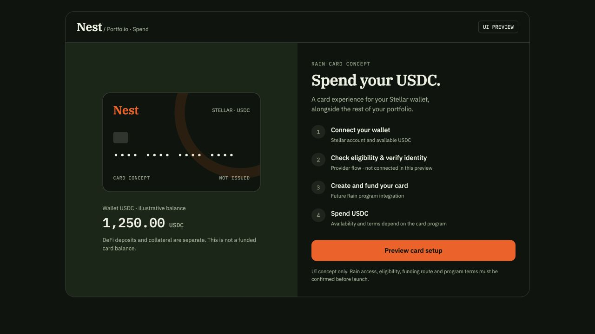
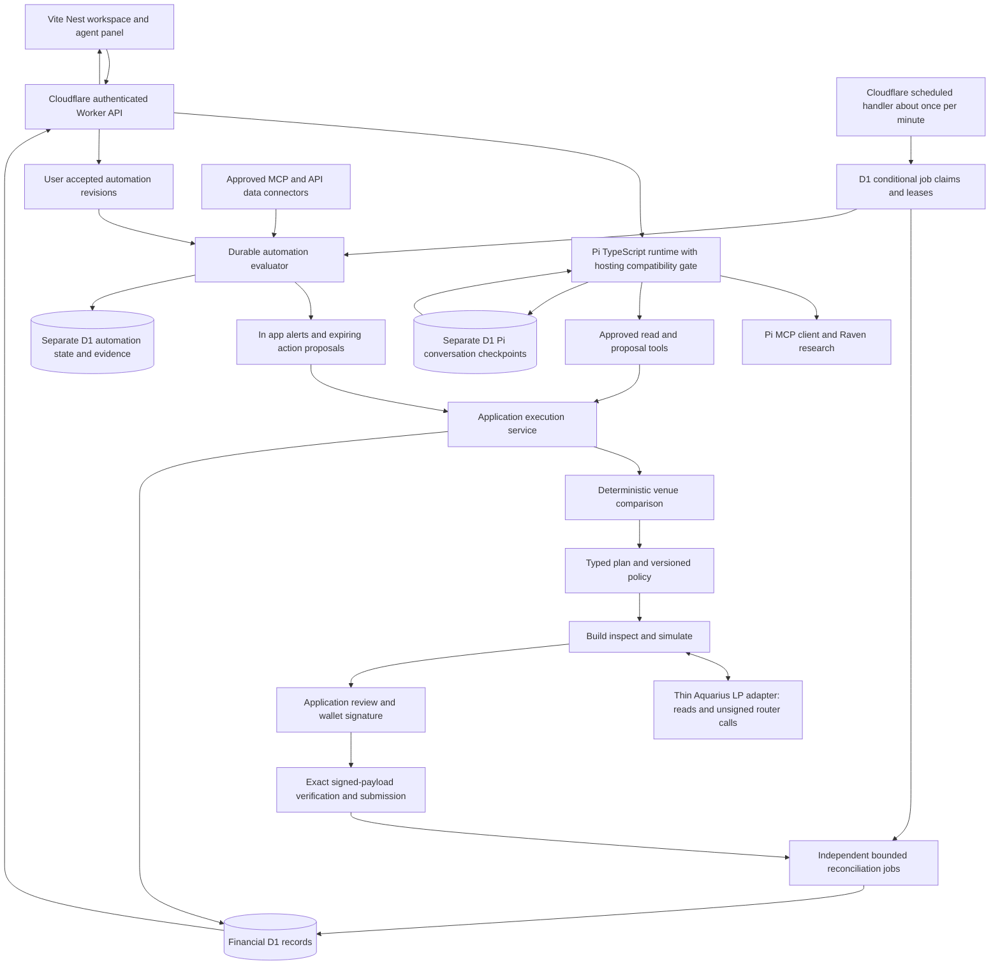

# Nest Technical Implementation Guide

This guide defines target product and architecture contracts. The README distinguishes implemented capabilities from remaining integration and production gates.

**Nest** — Discovery, research, and execution across Stellar DeFi.

Implement a workspace for amount-aware research, venue comparison, user-approved execution, user-defined monitoring automations, and position management. Mainnet is the primary deployment target. The same application must pass an independent Testnet integration profile. This guide defines the runtime, service boundaries, interfaces, data model, screens, adapter behavior, and acceptance tests required to implement v1.

Pi's embedded TypeScript SDK owns the agent runtime: provider access, conversations, context, skill access, tool calls, streaming, and Raven MCP connectivity. Application services own deterministic comparison, typed financial plans, policy, simulation, wallet approval, submission, idempotency, and reconciliation. The agent can propose an action; only the execution service can establish its financial state.

# Product scope

## P0 release

| Area | Required behavior |
| --- | --- |
| Research | Stellar chain/protocol/RWA data, source timestamps, functional tables, amount-aware opportunities, saved research, and natural-language research. |
| Automations | Connect X; create custom conditions over approved MCP/API data, inspect evaluation history, and receive alerts or expiring execution proposals. |
| Trade | Exact-input market swaps for eligible venue assets through Soroswap, with charts, real routes, fee/output bounds, wallet approval, and confirmed fills. |
| Credit | Compare Blend and XOXNO at the same inputs. Supply, borrow, repay, withdraw, and manage collateral using venue-native capabilities and risk measures. |
| Earn | Compare direct lending and approved vaults; complete their deposit/exit and supported reward lifecycles. Liquidity supports adding to, removing from, and monitoring existing two-asset Aquarius volatile/stable pools, with explicit LP-share and per-token bounds. |
| Portfolio | Wallet/receipt positions, collateral, debt, net value, performance coverage, pending workflows, funding, exits, and action history. |
| Spend preview | Portfolio card concept for Stellar USDC using Rain as the intended provider; UI only, with no issuance, funding or payment execution. |
| Agent | Pi SDK with approved research/planning tools, Raven access, streamed responses, compacted conversation context, and wallet-bound saved history. |
| Execution | Deterministic services with immutable plans, versioned policy, simulation, exact approval binding, durable claims, and receipt reconciliation. |

P0 execution coverage includes **Soroswap, Aquarius LP, Blend, XOXNO, DeFindex, Upshift/Gami, and Sentora**. Aquarius is the only P0 venue for LP execution; Soroswap remains the aggregated-swap integration. Soroswap and Sushi LP execution are outside P0. Gami Labs and Stake Capital curate vaults on Upshift. Sentora's evergreen USDC product also uses Upshift; its XLM, USDC, and PYUSD campaign deposit vaults are separate deployments. Reuse a verified contract/interface adapter across curators and access providers instead of counting every listing as a distinct protocol. The registry contains specific approved markets and vaults rather than enabling every permissionless deployment by protocol name.

Credit execution covers Blend and XOXNO. Templar adapters, transaction execution, authorization and settlement workflows are outside v1 scope. Existing source-labelled Templar research and external links may remain read-only.

Support any asset available through the integrated market/vault deployments when canonical identity, metadata, account eligibility, and execution checks pass. Do not hardcode an XLM/USDC-only execution universe. XLM/USDC and USDT0 are the primary walkthrough/default-selection assets where live venue routes exist. Resolve issuer/SAC/contract identity and decimals from verified registries, never from ticker alone or model-generated addresses. Respect venue restrictions, unsupported pairs, and user policy; show explicit exclusion reasons.

All required adapters must implement their complete supported lifecycle before v1 is complete. A read-only comparison or external link does not complete an execution adapter. Use separate mainnet/Testnet registries and per-adapter write flags; mainnet writes become available only after contract identity, account compatibility, economic bounds, and confirmed entry/exit validation pass.

## Core journeys

1. **Research to action:** enter asset, amount, horizon, and constraints → compare eligible options → inspect why each option ranks → review a plan → sign → follow confirmed position and available exit.

2. **Swap:** choose input/output and amount → obtain live routes → review net output and minimum received → sign → view confirmed token changes.

3. **Credit:** specify collateral and desired debt → compare cost and collateral terms → supply collateral and borrow using the venue's actual workflow → monitor → repay and withdraw.

4. **Earn:** choose the asset and liquidity needs → compare direct supply and vaults → deposit → track shares and net asset value → redeem into the supported asset. For Liquidity, choose an existing eligible Aquarius pool → enter both asset amounts → review expected consumption, unused inputs and minimum LP shares → simulate and sign → monitor the confirmed position → review and sign a partial or full share withdrawal with separate minimum amounts for both underlying assets.

5. **Fund and exit:** connect or watch an address, copy the funding address and required memo where applicable, show XLM reserve/fee needs, link to an existing supported funding provider, and verify arrival onchain. Wallet transfers require an amount, destination, relevant memo, preview, and signature.

6. **Automate research to action:** connect X or another available data source → describe a custom condition → inspect the typed rule and sample evaluation → activate → inspect trigger evidence → receive an alert or review and sign a fresh action proposal.

The primary prototype test is: a newcomer can discover a usable opportunity, understand its constraints, fund the wallet, enter the position, and exit without visiting a protocol app to complete a supported action.

# Interface and design

## Reference decisions

Apply Raven's visual system consistently across all screens. Use DefiLlama/RWA.xyz for analytics hierarchy, IRIS for credit intent capture, and a shared vault, chart and order-ticket layout. The screen contracts below are authoritative; reference sites supply visual patterns rather than application behavior.

| Reference | Implementation requirement |
| --- | --- |
| [Raven](https://raven.stellar.org/) | Deep green surfaces, cream text, orange actions, serif display type, monospace data labels, subtle borders, and restrained rounded cards. |
| [DefiLlama Stellar](https://defillama.com/chain/stellar) | Chain summary beside a historical chart; dense, sortable protocol rows; metric selectors; expandable protocol detail; visible time windows. |
| [RWA.xyz Stellar](https://app.rwa.xyz/networks/stellar) | Clear metric definitions, chain/asset/platform hierarchy, category filters, historical composition, asset identities, and issuer context. |
| [IRIS Borrow](https://app.iris.credit/borrow) | A compact intent form built around collateral, debt, term, maximum rate, and venue. The reviewed public form gates deeper selection behind wallet connection; our comparison form works before connection. |

## Visual tokens

Use Raven's source tokens as the initial theme. Source: [Raven site styles](https://github.com/stellar-experimental/stellar-raven/blob/b1dc8663b37a4795f50538918fdf5f4b08c6b054/src/site.ts#L75).

```css
--background: #0e150d;
--surface: #151f14;
--surface-raised: #182617;
--accent: #ff5500;
--accent-hover: #ff7a33;
--accent-tint: rgba(255, 85, 0, .13);
--text: #eef0e2;
--text-secondary: #9aa890;
--text-muted: #71806a;
--border: rgba(238, 240, 226, .12);
--border-strong: rgba(238, 240, 226, .22);
```

Use IBM Plex Serif for page titles, IBM Plex Sans for prose and controls, and IBM Plex Mono with tabular numerals for data. Raven's button/card radii are approximately 12/16px. Preserve font license notices. Additional semantic success, warning, and error colors must pass contrast checks and always include text or icons; orange denotes actions and selection, not positive financial performance.

The default desktop is workspace-first with a collapsible assistant on the right. Use a 64px header containing the Nest wordmark, five primary routes, search, network selector, and a top-right Guardrails button immediately beside Connect Wallet (or the connected WalletMenu). Keep this control visible across all workspace routes. Use the supplied tagline on the initial Research view or About panel, without a large marketing hero. Use the Nest wordmark; Raven's logo is not an application asset.

Use 24px desktop padding/gaps, a 12-column content grid, 44–52px data rows, a 340px trade/action ticket, and a 380px agent panel. At widths below 1440px, opening the assistant overlays it rather than squeezing chart, ticket, and chat into three narrow columns. Below 1024px, filters become sheets and tickets move below context; below 768px, use a single-column workspace and a full-height agent sheet. Test 375px, 1024px, and 1440px layouts with 44px touch targets.

Fonts: serif for titles only; sans for controls/prose; mono/tabular numbers for financial data. Orange indicates actions/selection. Give financial/status states separate accessible colors plus text/icons. Show missing data as unavailable, include units and time windows, and make exact values available on hover/copy. Implement visible focus, keyboard navigation, reduced motion, screen-reader labels, and focus restoration after sheets close.

## Research

Routes: `/research`, `/research/protocols/:slug`, `/research/assets/:assetId`, `/research/venues/:id`, `/research/markets/:id`, and `/research/saved`. The current design has three Research tabs: DeFi, RWAs, and MCP Contents. The venue map appears first in MCP Contents. The legacy venue and market detail routes resolve to the applicable protocol research page. Saved is a utility route; Automations lives in Lab, retaining the older `/research/automations` and `/research/automations/:id` aliases. The agent composer stays available without replacing the tables.

MCP Contents combines a source-enriched venue map with an inspectable Raven catalog of source families, operations and skills. The map includes captured Scout projects, distinguishes integration targets from research coverage, and links to DeFi protocol research. Protocol detail consolidates applicable market assets, roles, read surfaces, network-specific availability, supported design actions, exit conditions and source-matched yield pools. Research directories share numbered 10/25/50 pagination, visible row ranges, filter reset and return-context preservation. Preserve separate protocol, curator, platform and canonical-product identities. Published catalog metadata, runtime-readable data and amount-specific executable quotes are distinct states. Display catalog revision, upstream snapshot time, retrieval time and verification status; never mark an adapter live because a research source mentions it. The local design uses the published Raven catalog (60 operations, 20 skills, 202 sections, generated 8 October 2026), not an authenticated runtime inventory.

The first screen contains an asset/amount/horizon input, a chain metric summary and history chart, and the protocol table. A small opportunity strip uses the user's preferences and actual capital amount. Do not show personalized alpha or certainty labels unsupported by data.

Chain metrics include DeFi TVL, DEX volume, stablecoin supply, and separately defined RWA values. Protocol columns include category, Stellar TVL, changes over selected periods, fees/volume when available, supported actions, and data time. Market views specialize the columns: supply APR/APY, borrow APR, incentives, utilization, available capacity, vault net yield, fees, and withdrawal conditions. Tables support real filtering, sorting, search, pagination, and saved filters.

RWA views expose asset name, ticker, issuer/platform, asset class, Stellar identity, source-defined value, holders, and known eligibility/redemption conditions. Keep distributed value, represented value, stablecoin supply, DeFi TVL, and secondary-market liquidity separate. Chain-wide RWA value does not establish tradability. Preserve source definitions and show disagreement between providers rather than averaging incompatible metrics.

Protocol detail combines description, metrics, chart, markets, dependencies, audit/admin/oracle references, and available actions. Selecting an executable row pre-fills the relevant action form. Unsupported opportunities explain the missing capability and provide a verified protocol link.

Live Blend rates on Research support click, text selection and keyboard activation. The selection command retains the exact pool, asset and rate context. Supported lending commands create the existing typed Blend intent and open its reviewed proposal in place; other questions go to Ask Nest with the selected source text. This does not bypass eligibility, trustlines, policy checks or wallet signatures. Credit and Supply rate tables retain the same command behavior.

### Live Trade integration

Keep the approved candlestick chart, captured reference series, and full searchable market window: XLM, AQUA, EURC, USDT0, PYUSD, SolvBTC and EUTBL, all quoted in USDC. Preserve source capture times and labels; choosing a research asset must not substitute a live Testnet candle series. Swap controls additionally allow USDC as a payment asset. Only the integrated XLM/USDC pair creates executable swap intents; other markets remain inspectable with an explicit execution-unavailable state. The separate `/api/markets/price-history?interval=15m|1h|4h|1d` endpoint supplies network-specific Stellar observations for future live contexts. Neither a captured chart nor a live history observation is an execution quote.

Debounce edited swap amounts for 600ms before creating a fresh typed intent. Quote and review state must match the current assets and amount; changing them discards the old display. Preserve signing/submission locks. Read spendable balances from the account endpoint, calculate Use max with bigint amounts and an explicit XLM fee buffer, and refresh balances and recorded activity after settlement. Missing cost basis remains unavailable rather than becoming invented positions or P&L.

## Credit

Route: `/credit`, with Borrow and Supply modes and a My positions panel. Use the IRIS form pattern with these fields: collateral asset and amount, debt asset and desired amount, horizon, maximum borrow APR, and venue preference defaulting to Best available. Horizon is a comparison assumption; display actual fixed/floating rate type and maturity only when the venue supports it.

Results compare Blend and XOXNO at identical inputs: eligible pair, debt available, effective initial LTV, maximum LTV, liquidation threshold or venue-native equivalent, rate type, estimated horizon cost, fees, collateral yield where applicable, execution steps, and expected settlement path. If the requested debt exceeds a venue's capacity, exclude it with a reason; do not silently lower the amount. Recompute after inputs change. Offer supply, withdraw, repay, and collateral management from the same position view.

## Earn

Routes: `/earn` and `/earn/:opportunityId`. Use a filter rail and horizontal opportunity rows. Filters cover asset, protocol/curator, evergreen versus campaign product, withdrawal condition, incentive dependence, and supported risk constraints. Each row shows asset, provider, base yield, incentives separately, net yield methodology, TVL, fees, exit availability, and freshness.

Compare Blend/XOXNO direct supply with DeFindex, Upshift/Gami, and Sentora vault products, keeping exposure, incentives, and withdrawal differences visible. Sentora includes the Upshift evergreen USDC vault and separate XLM/USDC/PYUSD campaign deposit vaults. Detail pages show product type, curator, underlying protocols, fee schedule, reward methodology, deadlines, redemption mechanics, and a sticky action panel. Use Deposit/Withdraw/Claim only when supported; show share-price history only for products that actually issue shares. For campaigns, display each deposit lot, accrued versus claimable rewards, and the rewards forfeited by the selected withdrawal. For delayed redemptions, show requested amount, pending state, earliest availability and claim/settlement step. No placeholder APYs, assumed share decimals, or invented instant exits appear as live data.

### Liquidity — Aquarius P0

Add a **Liquidity** section within Earn, beside the vault/direct-supply views; do not add another primary navigation item. Use `/earn/liquidity` for pool discovery and `/earn/liquidity/:poolId` for pool detail, the Add/Remove ticket and the connected position. If the application keeps `/vaults` as the current Earn entry, expose Liquidity from that group and retain these canonical routes. `poolId` is an application registry ID, not a user-supplied contract address. Keep vault receipts and LP shares visually distinct.

P0 covers existing, registered **two-asset volatile and stable Aquarius pools**, two-asset deposit budgets, partial/full LP-share withdrawals and position monitoring. There is no pool creation, concentrated position or price-range editor, one-asset zap, automatic swap-to-balance or automatic rebalancing in this flow. Do not display Soroswap or Sushi as LP execution alternatives. Their pools may still appear as source-labelled research, and Soroswap may route swaps through underlying venues.

| Surface | Implementation contract |
| --- | --- |
| Pool list | Search/filter by canonical asset pair, pool type, fee tier and availability. Show verified pool/router identity, reserves/TVL where priced, trading-fee yield separately from incentive yield, measurement window, withdrawal conditions and freshness. Loading, no eligible pool, unverified deployment, stale state and paused/unavailable actions have explicit states. Research APY alone is not an executable opportunity. |
| Add ticket | Two asset pickers are fixed to the selected pool, with two exact decimal amount inputs and verified spendable balances. A user-entered amount is a maximum desired contribution for that token. A ratio suggestion never edits the other amount without explicit acceptance. Preview expected actual amounts consumed, expected unused amounts, LP shares minted, **minimum LP shares**, all maximum fees, expiry, network and source ledger. Keep withdrawal timing beside the inputs and in the shared owner review. |
| Remove ticket | Load an owned LP position; enter exact shares or select a user-requested fraction/full balance. Server-derived Max excludes shares reserved by unresolved actions. Show shares to burn, expected receipt of each underlying token and a **separate minimum for each token**, fees, expiry, trustline/authorization requirements and withdrawal timing. Display outcomes in asset units before any optional USD conversion. No single-asset exit or implicit reward claim. |
| Review and status | Use the existing `ActionReviewSheet` and persistent state machine for both actions. Label simulation results as expected; only confirmed effects are actual. A changed pool, amount, fee, economic bound or expiry requires a new review. Show rejection, slippage failure, pending confirmation, ambiguous receipt and reconciled success without inferring an outcome from an SDK return or stale indexer row. |
| Position | Show LP-share balance, underlying exposure, fresh simulated redeemable amounts and verified valuation where available; keep unavailable fields explicit. Separate pool fee statistics, position-attributable observations, pending incentive rewards and actually claimed rewards. Display pool/position changes with their observation times. Monitoring can alert or propose an action, never sign, withdraw, claim or rebalance. |

The [deposit guide](https://docs.aqua.network/developers/code-examples/deposit-liquidity) describes desired amounts versus consumed amounts and simulation-based minimum shares. The [withdrawal guide](https://docs.aqua.network/developers/code-examples/withdraw-liquidity) documents burning shares for token outputs with per-token minimums. Nest must preserve those economic distinctions rather than treating an LP deposit as a single-asset vault subscription.

## Trade

Route: `/trade?pair=:pairId`. The default pair is XLM/USDC, with USDT0 available where an executable route exists. Pair selection covers all technically eligible venue assets. Use a market header and interval selector, chart on the left, a market-swap ticket on the right, and wallet activity below. The route panel identifies venues, expected output, minimum received, fees, price impact, route timestamp, and expiry. Quote both input directions. P0 uses exact-input swaps; expose additional trade modes only after adapter capability tests.

Use **TradingView Lightweight Charts**, with crosshairs, interval controls and a separate order ticket. The price-data adapter is separate from the trading adapter. Use underlying asset history or oracle reference prices when exact DEX pool history is sparse, with the reference asset and source clearly labeled. Keep every trading market quoted in USDC, normalized using observed USDC/USD rather than assuming a dollar peg. All trading assets render as candlesticks. Aggregate verified trades into OHLCV and available oracle observations into explicitly labeled sampled-price OHLC buckets. Daily issuer NAV uses one candle per publication date, with equal O/H/L/C for a single observation. Never infer unobserved intraperiod extremes or fabricate volume. USDC is fixed as the quote currency and is excluded from the base-asset picker. Show sparse history honestly. Never fabricate candles, volume, future bars, or a synthetic order book. A reference chart price is not an executable quote. Preserve the library's [license](https://github.com/tradingview/lightweight-charts/blob/master/LICENSE) and [notice](https://github.com/tradingview/lightweight-charts/blob/master/NOTICE).

## Portfolio and the agent drawer

Portfolio contains wallet balances, collateral/debt, direct supply positions, vault positions, action history, and funding/withdraw controls. Show total assets, liabilities, net value, and valuation time. Claim actions appear only where the adapter supports them.

Chat, recommendation cards, and buttons all create the same typed intents. The agent drawer explains proposed actions, shows alternatives and excluded venues, asks for genuinely missing inputs, and presents the shared review component. A prose response cannot create a separate execution path.

Provide `/chat` as the full conversation workspace as well as the contextual drawer. Use the shared conversation layout: a restrained transcript, persistent composer, compact application-owned action card and a separate owner-review sheet. Inline cards show exact requested amounts, selected venue, economic bounds, maximum fees and state; deposits keep exit timing visible. Expose preparation activity on demand. Stop response cancels generation only; dismissal/cancellation of an eligible plan is separate. Request missing amounts, assets or ambiguous products before preparing. Wallet signing, submission and confirmation still follow Nest's application state machine; keep delegation and runtime behavior outside financial authority. The UI behavior and source evidence are specified in `design/nest/ui/spec/discovery.json` and `discovery.html`.

## Rain card spending preview

Include a **UI-only** card spending concept in Portfolio under a secondary **Spend** view, without adding another primary navigation tab. Use the supplied two-column card/onboarding composition: masked Nest card on the left, a **Spend your USDC** heading and four-step flow on the right. Apply Nest's forest/cream/orange tokens and typography; stack the panels on mobile. Keep a persistent **UI preview** label and **Not issued** card state.

Rain has announced Stellar card-program support and documents a live MoneyGram integration using Stellar and Rain infrastructure. These establish the reference direction; Nest's exact Stellar USDC asset, program access and Freighter funding model still need confirmation before a live integration. Do not assume an arbitrary connected wallet can be charged directly. [Rain announcement](https://www.prnewswire.com/news-releases/rain-expands-support-to-solana-tron-and-stellar-enabling-more-partners-to-launch-stablecoin-powered-card-programs-302467576.html), [Rain MoneyGram case study](https://www.rain.xyz/resources/moneygram-card-goes-live-on-rain)

| Element | Implementation contract |
| --- | --- |
| Entry and state | Portfolio → Spend; enable through a presentation-only feature flag. Card state is `preview`, never an issued/active financial instrument. |
| Card face | Nest wordmark, Stellar/USDC context, masked decorative details and Not issued. No real PAN, CVV, cardholder data or payment-network logo without an authorized program. |
| Balances | Show wallet USDC separately from card-available balance. The mockup uses an explicitly illustrative wallet amount; card balance remains unavailable/not connected. Never include supplied, collateralized, locked, queued or vault funds as immediately spendable. |
| Onboarding | Illustrate Connect wallet → Check eligibility/verify identity → Create and fund card → Spend. These are proposed steps, not completed provider states. Reuse existing wallet state only as a read-only context in the eventual app preview. |
| Primary action | **Preview card setup** opens local explanatory preview content. No provider onboarding, identity-data collection, terms acceptance, card issuance, fund transfer or payment occurs. |
| Responsive and accessible behavior | Side-by-side at desktop widths; stacked below approximately 620px. Use visible labels, keyboard-operable preview controls, focus indicators, 44px targets and announced expanded content. |
| Data and execution boundary | No Rain API calls, credentials, new financial tables, agent tools or payment jobs in P0. Optional real wallet balance reads use existing portfolio services. Preview actions cannot create intents, approvals, signed payloads, financial history or ledger effects. |

A future live Rain program is a separate integration requiring program/documentation access, eligibility/onboarding, supported asset/issuer and wallet-funding verification, provider credentials and transaction-event reconciliation. It must not automatically withdraw vaults, release collateral or sell assets to fund spending. Those actions, if later supported, need their own explicit intent, withdrawal disclosure and normal execution review. No Rain credentials are needed for this UI mockup.

Acceptance: preview content and illustrative balances remain clearly labeled; no card is marked active; the button updates only local UI; no signing, financial submission, identity upload or balance mutation occurs. Deposited DeFi value never becomes card spending power through presentation alone.

[Editable Rain card mockup](../design/nest/mockups/rain-card.html)



## Shared components and interaction contracts

```text
AppShell
  Header: NestWordmark, MainNavigation, GlobalSearch, NetworkSwitch, GuardrailsButton, WalletMenu
  WorkspaceOutlet
  AgentPanel
  ActionReviewSheet
  GuardrailsDrawer
  ToastRegion

Data: MetricTile, SourceStamp, FreshnessBadge, PartialCoverageBanner
Forms: AssetPicker, DecimalAmountInput, HorizonInput, ConstraintEditor
Markets: ProtocolTable, MarketComparisonTable, OpportunityRow, ChartPanel
Execution: PlanSummary, AssetDeltaList, FeeBreakdown, RiskFacts,
           WalletApprovalStatus, ExecutionTimeline, ReceiptLink,
           WithdrawalTimingDisclosure, GuardrailWarning
Liquidity: PoolIdentity, LiquidityPoolTable, TwoAssetAmountInputs, LpShareInput,
           LpBoundsPreview, LpPositionExposure, PoolYieldBreakdown
Portfolio: PositionSummary, PositionActions, LpPositionSummary, MemoryInspector
```

All form amounts remain decimal strings in the client. The server validates, resolves canonical assets, and converts to raw units. `Max` comes from server capacity/balance/fee/reserve calculations. Asset selection shows network, ticker, and issuer/contract identity where ambiguous. Never silently substitute an asset, debt amount, venue, or network.

Tables use controlled server-backed search/filter/sort/pagination, sticky headers, pinned identity columns, and right-aligned numeric cells. A row/detail link navigates; a separate action button drafts an intent without nesting interactive buttons inside a row-as-button. Use text labels for risk/availability, not color alone. Query URLs can retain public filters, pair, network, and interval; do not place balances, capital amounts, wallet-specific actions, or private strategy notes in share URLs.

The single `ActionReviewSheet` fetches a prepared plan by ID/revision/digest. Show network, exact token changes, receiver, minimum received/maximum spend, displayed maximum fees by asset, active guardrail revision and warning facts, affected position/health, expiry, and transaction-step count. For every deposit leg, prominently show withdrawal duration, lockups, cooldowns, queues and variable or unknown timing beside the amount and before the approval/sign action; do not hide this disclosure in expandable technical details. Keep issuer/contract/XDR details expandable. A changed input/quote/policy invalidates the sheet; a wallet response after expiry is rejected. The same component is used from chat, tables, Trade, Credit, Earn, and Portfolio.

Render plan cards only from validated application plan events or a fresh plan fetch. Pi prose cannot create a native Approve/Sign control, mark an action confirmed, or embed executable HTML. Sanitize Markdown and validate source links independently. `Stop response` cancels generation; `Cancel plan` is a separate application action available only while cancellation is technically possible.

## Guardrails drawer

Place a labeled **Guardrails** button in the top-right header immediately beside **Connect Wallet**, retaining that position beside the connected wallet menu. Use Nest's forest surface, cream text, orange primary action and existing form/focus tokens. Open a right-side modal drawer approximately 440px wide on desktop and full-width on small screens; keep the title and footer visible while the fields scroll. Trap focus, label every input and unit, support Escape/Cancel, and restore focus to the trigger.

Show wallet/network scope, current saved revision, and separate **Saved** and **Unsaved changes** states. Fields edit a local draft. **Save preferences** is the only persistence action; **Cancel**, closing, or merely opening the drawer never applies changes. Guests can inspect and edit a transient draft, with Connect Wallet to save using the normal ownership-verification flow. Switching wallet/network reloads that scope and never carries an unsaved draft into another account. A version conflict preserves the draft and offers reload/review of the current saved revision.

Group the controls as Trade, Fees, Lending, Data freshness, and collapsed Optional amount caps. Show a concise effective-rule summary beside the inputs, distinguishing a warning from a blocker and identifying any tighter chain/venue requirement. Proposed numerical values are labeled **Suggested · not yet confirmed** until explicitly saved; they are not silently accepted on load. No additional global amount cap is required to save or execute an approved P0 intent. Save success invalidates affected prepared plans and requests a fresh preview, without executing anything.

| Setting | Stored contract and enforcement | Proposed initial value |
| --- | --- | --- |
| Slippage | `slippageBps`: integer basis points; derive enforceable minimum output using verified decimals and conservative rounding. Validate against supported route constraints. | 50 bps = **0.5%**, unconfirmed. |
| Price impact | `priceImpactWarningBps`: integer basis points or null; warning when observed impact is strictly above the accepted threshold. A warning alone is not a hard exclusion. Show the venue's impact methodology and unavailable state. | Warn above 100 bps = **1%**, unconfirmed. |
| Quote expiry | `quoteMaxAgeSeconds`: positive integer, bounded by provider and transaction/venue validity. Show requested age and the shorter effective expiry. | **30 seconds**, unconfirmed. |
| Fees | Approve the displayed maximum for each charged asset in the exact action review. `customFeeCeilings`: optional asset/raw-amount limits; null means no extra custom ceiling, not unlimited unreviewed fees. Network/resource and venue fees remain visible. | No extra ceiling. |
| Lending health | `lendingByMetric`: venue-native metric identifier, optional hard minimum and independent warning threshold stored as decimal strings. Apply to post-action health; preserve the adapter's direction and units. Never invent a common health factor for unlike protocols. | Warn below **1.5** only for compatible health-factor metrics, unconfirmed; no universal custom hard minimum. |
| Data freshness | `maxDataAgeSecondsBySource`: accepted tolerances keyed by registered source/feed. Compare observation/as-of time during quote and preview generation; effective validity is no looser than mandatory source/oracle/venue requirements. | Source-specific values require configuration/confirmation; no invented universal age. |
| Optional amount caps | Nullable, explicitly enabled funding, per-action/cumulative spending, daily turnover or borrowing limits with asset/unit, scope and window definitions. Missing limits are disabled, never zero. Native balance, reserve, capacity and liquidation checks still apply. | All extra global amount caps disabled. |

Use strict schemas and fixed-point/integer representations, rejecting unknown fields and unsupported metric/source IDs. Reuse `execution_policies` / `policy_versions` and the existing policy API; do not create a second preference authority. Persist only accepted revisions, with expected-version comparison and request idempotency. The frontend Save handler is separate from Pi tools. The agent can read saved settings or propose a draft for user inspection, but has no policy-write capability. Learning runs, memory edits, source messages and automations cannot accept a suggestion.

Neither a Save action nor a warning acknowledgement approves a financial action. Each prepared plan binds the saved policy version, exact intent amount, economic bounds, displayed maximum fees and disclosure facts; changed policy or economic facts require fresh review. Tightening preferences cannot make a chain-invalid action valid, and loosening them cannot override the venue's requirements.

| Screen | Layout and exact interaction contract |
| --- | --- |
| Research | Capital/asset/horizon bar, chain KPI/history area, dense protocol/market/RWA tables. Overview/Protocols/Markets/RWAs/Saved are secondary views. Each metric includes units, observation time, and definition. A table action pre-fills the relevant form. |
| Credit | IRIS-style Collateral, Debt, Horizon, Max APR, Venue fields; Borrow/Supply modes; comparison to the right or below. Preserve venue-native risk measures and supported withdrawal conditions. Show all eligible Blend/XOXNO quotes plus exclusions. |
| Trade | Pair/interval/market header, real chart, exact-input ticket, route/size-dependent impact panel, and activity below. No perp leverage/funding fields or invented aggregate order book. |
| Portfolio | Assets/liabilities/net value, valuation/coverage time, wallet/supply/credit/vault groups, and pending workflows. Every supported position has an exit action. Separate receipts from backing to prevent double counting. |
| Agent | Collapsible right panel with conversation switcher after wallet verification, streaming text, source chips, tool-progress summaries, proposal cards, stop/retry controls, and Connect wallet to save for guests. Never expose raw hidden reasoning, credentials, or signed payloads. |

| State | Required behavior |
| --- | --- |
| Loading | Skeletons and bounded progress; no stale quote remains actionable. |
| Partial coverage | Preserve successful results and list unavailable/excluded venues with reasons. |
| No route | Explain limiting constraints and offer explicit edits. |
| Stale or expired | Disable review/sign and prepare a new revision. |
| Wallet or network mismatch | Show expected account/network; invalidate the prior prepared plan before switching. |
| Awaiting signature | Keep the exact review visible; reject a returned stale/mutated payload. |
| Submitted or reconciling | Show receipt/hash and progress; never label success before confirmation. |
| Partial completion | Show completed steps, remaining exposure, and a separately reviewed recovery action. |
| Confirmed | Show actual confirmed effects and refresh positions. |
| AI quota or provider failure | Show retry/limit state inside the agent panel; keep manual research and forms available. |

At 375px, use a compact header with Nest, a network/status control, a compact labeled Guardrails control beside the wallet control, and an overflow menu. Guardrails opens the same settings as a full-width mobile drawer. Put the five primary routes in a labeled bottom navigation or route sheet, and open global search from an icon. Keep the agent launcher separate; do not cram desktop controls into the mobile header. The bottom-nav choice is a design-review baseline.

Research/history defaults, exact breakpoints, navigation labels, and ticket dimensions are implementation baselines for design review. Preserve the workspace-first/side-panel interaction and the Raven-derived theme while refining them.

# Application architecture

## Stack and modules

Use Vite/React/TypeScript, TanStack Router/Query, Tailwind and the shared UI package. Cloudflare Workers serves HTTP/SSE APIs, while D1 stores authoritative application state through `env.DB`. Package boundaries separate UI, domain, data, policies, adapters, jobs and the agent runtime.

Use the pinned Pi dependencies in `packages/agent-runtime` for the model/provider/tool loop. Raw amounts, plans, policy, signing and chain state remain ordinary application services.

Separate HTTP/SSE request handling from background job handlers. Cloudflare Cron invokes the Worker's actual `scheduled()` handler roughly once per minute; bounded dispatchers ingest due data, evaluate accepted rules and reconcile submitted transactions. Persist jobs/outbox, due times, attempts, lease ownership, fencing revisions and retry cursors in D1. Claim work with atomic conditional statements, uniqueness constraints and guarded transactional batches; keep network calls outside the database atomic unit. Expired leases permit safe recovery, not duplicate financial effects. Cron is a wake-up signal rather than durable state or an exact timing SLA. Retain exact transaction hashes and financial idempotency across retries. Do not port PostgreSQL row-lock or `SKIP LOCKED` code. [Cron Triggers](https://developers.cloudflare.com/workers/configuration/cron-triggers/), [D1 batches](https://developers.cloudflare.com/d1/worker-api/d1-database/)

## Private demo deployment

A private deployment must enforce wallet ownership and an explicit access policy on server APIs and streams. Production authentication and tenant isolation are release gates; guest research behavior alone does not meet them.

Host the frontend as static assets on Cloudflare and route same-origin `/api/*`, OAuth callbacks and SSE through the application Worker. Serve the Vite assets through the application Worker and its declared asset binding. Pin and test its compatibility date, CPU/subrequest limits and timeouts. Configure the one-minute scheduled handler explicitly and keep reconciliation independent of slower research/model work. Mainnet and Testnet use separate complete D1 bindings; keep automatic Worker Previews disabled until their resources and service bindings are explicitly nonproduction. Local `remote: false` does not isolate deployed previews. [Worker assets](https://developers.cloudflare.com/workers/static-assets/), [Preview resources](https://developers.cloudflare.com/workers/previews/resources/)

Create dedicated `nest-mainnet` and `nest-testnet` databases before deployment. The committed binding IDs are local-development placeholders. Follow the README and Cloudflare setup guide to provision new resources, configure recovery, and select explicit migration/deployment targets.

Choose the Pi-compatible hosted model for research/planning quality and verify it on the representative demo tasks. Retain request deadlines, token/context limits, bounded tool loops, concurrency controls, provider rate-limit handling and usage visibility. Set operational limits from measured workload. Financial execution remains bound to the approved intent amount, reviewed maximum fees, and explicit wallet approval. Additional user spending caps are optional and separate from operational model/API limits.

Provision X read access and sufficient credits for the selected demo accounts, queries and windows. Fetch incrementally, share permitted cached observations across applicable rules, and expose source timestamps and coverage. Poll fresh sources at roughly one-minute cadence where the upstream supports it; report slower native refresh intervals and API limits explicitly. A one-minute scheduler does not make a source publish new data every minute.

Configure app secrets and hosted model access through Worker secrets, complete Raven OAuth through Nest's actual connector, and obtain venue/X credentials progressively as the corresponding adapters are wired. The prepared public DefiLlama feeds need no key; the dated RWA.xyz snapshot needs no API key. A future licensed live RWA connector is optional. Soroswap/OpenRouter read-access checks and public DeFindex discovery do not establish complete live trading or authenticated transaction-building capability. Surface missing access honestly without replacing required P0 execution integrations with fixtures.

## Runtime dependencies

Pin the Pi packages below exactly and commit the resolved lockfile. Do not mix older namespaces or Pi forks. Add `pi-agent-core` directly only if Nest imports it; otherwise keep the SDK's matching transitive version. Use a maintained Node release satisfying the SDK minimum for local tooling, package resolution, collectors and CI. The engine declaration below is not proof that Pi runs in Workers; validate that hosting separately. [Pi release](https://github.com/earendil-works/pi/releases/tag/v1.4.0), [package manifest](https://www.npmjs.com/package/@earendil-works/pi-agent-core/v/1.4.0)

```json
{
  "engines": { "node": ">=24" },
  "dependencies": {
    "@earendil-works/pi-agent-core": "1.4.0",
    "@earendil-works/pi-ai": "1.4.0",
    "@earendil-works/pi-mcp": "1.4.0",
    "typebox": "1.3.27"
  }
}
```

Use Zod at application boundaries and TypeBox only for the pinned Pi tool-schema interface. Keep conversions explicit. Pin application/UI/database package versions in the implementation lockfile after compatibility tests rather than copying a reference app's package manifest. The Aquarius LP adapter may reuse the official `@aquariusdefi/sdk` for signer-free reads and verified unsigned-building utilities if available. Before adding it to the runtime, select and pin an exact release in the workspace catalog, test it with the pinned Stellar SDK and Worker runtime, and contract-test its decoded results. Do not add a key-bearing SDK client or depend on its automatic transaction helpers. If its read surface cannot run in Workers, use the documented Aquarius REST API and existing Stellar SDK; keep the same thin adapter contract.

### Pi hosting compatibility gate

Prove the pinned Pi SDK in the actual Worker build/runtime before choosing it as the conversation host. Exercise package bundling, session construction, the explicit ResourceLoader and credential store, approved tool calls, streaming/cancellation, compaction, complete checkpoint restore and Raven OAuth/callback connectivity. A Node engine declaration, successful import or compatibility flag is insufficient: Workers exposes a subset of Node APIs, including APIs that may be stubs. Pin the compatibility date and configure only the flags required for that date. Filesystem paths are virtual/ephemeral, never durable conversation or credential storage. [Node compatibility](https://developers.cloudflare.com/workers/runtime-apis/nodejs/), [Filesystem](https://developers.cloudflare.com/workers/runtime-apis/nodejs/fs/)

The current runtime uses Pi agent-core, pi-ai and pi-mcp inside Durable Objects. Unsupported coding-agent filesystem and terminal APIs are excluded. A different host would require a separate architecture decision and the same restricted financial boundary.

```text
apps/web                    Vite-oriented workspace frontend and static assets
apps/worker                 deployed HTTP/API/SSE and scheduled handlers, D1 bindings
packages/domain             identities, strict intents, plans, positions
packages/agent-runtime      Pi sessions/providers/skills/streaming and Pi MCP Raven client
packages/execution          deterministic comparison, plan lifecycle, preparation and submission
packages/policy             pure versioned financial rules and reason codes
packages/adapters           Soroswap swaps, Aquarius LP, Blend, XOXNO, DeFindex, Upshift, Sentora, Stellar
packages/jobs               durable job claims, ingestion/evaluation/reconciliation handlers
packages/data               public DefiLlama, dated RWA snapshot, X, signals, prices and provenance
packages/automations        rule schemas, capability validation, evaluation, triggers and delivery
packages/memory             accepted preferences, bookmarks and reviewed proposals
packages/ui                 Nest theme, tables, forms, agent panel and review components
packages/evaluation         P1 offline replay and Harness² bridge
```



Pi's allowed tools are `raven_search`, `raven_execute`, `read_skill`, `list_markets`, `compare_opportunities`, `get_portfolio`, `get_plan`, `propose_intent`, `propose_plan`, `propose_preference`, `get_signal_catalog`, `get_automation`, `propose_automation`, and explicitly authorized bookmark operations. Application tools accept IDs and typed inputs; they cannot accept arbitrary URLs, contract addresses, executable code, or raw signed transactions. Draft/proposal creation uses request/digest idempotency.

Never expose prepare/approve/sign/submit, policy or registry writes, shell/filesystem/coding tools, package installation, arbitrary HTTP, or dynamic tool registration to the model. `raven_execute` is an allowed remote research operation, not access to Nest's execution engine or a local JavaScript interpreter. HTTP endpoints remain responsible for execution authorization and ownership checks.

| Tool group | Inputs and returned authority |
| --- | --- |
| Raven search/execute | Validated research schema; fixed server/operations; return source envelopes only. |
| Skill read | Registered skill ID/version; return approved text, never a path or arbitrary URL. |
| Markets/comparison | Strict intent or market filters; return application-computed quotes/ranking/exclusions and observed times. |
| Portfolio/plan read | Owned or explicitly watched account/plan IDs; return current application state. |
| Intent/plan proposal | Validated domain input plus request/digest key; return an immutable draft/proposal ID, never approval or signature state. |
| Automation read/proposal | Owned rule IDs or typed drafts over registered signals; return capability coverage and a draft revision. Activation requires explicit authenticated user acceptance. |
| Preference/bookmark proposal | Verified-wallet ownership and typed content; apply only the supported explicit user action. |

## Embedded Pi runtime

The deployed runtime uses `@earendil-works/pi-agent-core` with `pi-ai` and `pi-mcp`, pinned to compatible versions. `packages/agent-runtime/src/agent.ts` constructs `Agent` explicitly; it does not load the coding-agent facade, terminal tools, filesystem resources, CLI extensions, or ambient model configuration.

The host supplies a selected model, a stream function, a scoped API-key callback, a fixed system prompt, approved tools, finalized messages, a conversation identifier, and turn limits. `assertExactTools` rejects an unexpected registry. The bridge's `beforeToolCall` blocks tools outside that registry and stops a turn that exceeds its tool-call allowance. The host bounds duration and model output.

```typescript
import { createNestAgent, DEFAULT_TURN_LIMITS, runTurn } from '@nest/agent-runtime/agent';
import { assertExactTools } from '@nest/agent-runtime/tools';

// All values are supplied by the application host after validation.
assertExactTools(approvedTools, approvedNames);
const agent = createNestAgent({
  model,
  streamFn,
  getApiKey,
  systemPrompt,
  tools: approvedTools,
  messages: finalizedMessages,
  limits: DEFAULT_TURN_LIMITS,
  sessionId: conversationId,
});
const unsubscribe = agent.subscribe(publishApprovedAgentEvent);
try {
  await runTurn(agent, userText, DEFAULT_TURN_LIMITS.deadlineMs);
} finally {
  unsubscribe();
}
```

SQLite-backed Durable Objects own conversation admission, finalized messages, application event IDs, cancellation and replay boundaries. Restore a generation from finalized messages without granting it financial approval authority. Tool definitions explicitly declare whether replay is safe; state-changing tools run sequentially. A generation's retry or cancellation cannot sign, submit, or cancel a financial transaction.

The wider v1 contracts include registered skills, context compaction, saved authenticated history, and richer checkpoint inspection. These require explicit application integrations and their acceptance tests; they are not supplied by enabling a coding-agent CLI. Skills must be read by registered ID/version, never an arbitrary file path. Compaction must preserve factual provenance and leave financial D1 records untouched.

## Raven MCP connection

The Pi runtime adapter owns Raven connectivity using `@earendil-works/pi-mcp` `McpClient` and `StreamableHttpTransport` against the fixed `https://raven.stellar.org/mcp` endpoint. Inject caller-owned OAuth/token storage and browser callback handling through the public auth interfaces. Store tokens/PKCE state encrypted and tenant-scoped. Do not reuse a developer's global CLI credential files. [Pi MCP interfaces](https://github.com/earendil-works/pi/blob/v1.4.0/packages/mcp/README.md)

Validate the two server schemas and expose only fixed `raven_search`/`raven_execute` wrappers. New remote tools never auto-register. Pi's stock MCP extension is not loaded automatically in SDK sessions; the two-wrapper integration avoids its CLI discovery, loopback defaults, broad tool search, and file logging. Do not introduce a second MCP client stack.

Preserve Raven's structured success/error envelopes, source timestamps, and caveats. Its remote code operation retrieves documentation/ecosystem context and cannot submit through Nest. Returned prose, source links, and code snippets remain untrusted data. Keep current rates, capacity, positions, and transaction construction in application adapters. [Raven contract](https://raven.stellar.org/docs)

## Model and credential configuration

The implemented provider is OpenRouter with a server-held API key. `apps/worker/src/agent/models.ts` registers the provider explicitly and rejects unknown or paid models. The committed model is `thinkingmachines/inkling:free`; a provider's model must have a free identifier and zero configured input/output/cache prices. There is no automatic paid fallback.

The Worker passes its own API-key callback into Pi. It does not import desktop authentication files, resolve credentials through shell commands, or expose credentials to browser code or tool output. Tests use a scripted provider with no live API calls. Provider failures remain explicit errors or unavailable states.

Additional provider/OAuth support is a future integration decision, subject to the same explicit model selection, request deadlines, output limits, bounded concurrency and credential isolation. Provider changes cannot expand financial permissions or repeat a submitted transaction.

## Wallet authentication

Public research and transient chat require no wallet. Saved conversations, preferences, and bookmarks require a connected wallet plus verified ownership through an expiring, domain/nonce/network-bound challenge. A watched address is read-only. Before verification, keep Pi history in memory and do not persist chat content; provide a Connect wallet to save action. If a user chooses to save the current transient conversation after verification, bind it to that wallet explicitly.

Name browser authentication records `auth_sessions`; keep them separate from Pi conversations. A wallet connection, a provider login, and Raven OAuth are different credentials and never substitute for financial approval. Apply tenant-scoped storage, CSRF protection, rate limiting, and secret redaction. Every financial transaction still needs its own explicit wallet signature.

Implement G-account login with a SEP-10-compatible challenge using Stellar SDK helpers. `POST /api/auth/challenges` takes account/network and returns an expiring, server-signed challenge bound to Nest's domain, browser session, nonce, and network. The wallet validates the challenge before signing. `POST /api/auth/verify` verifies the exact challenge, expiry, one-time nonce, account signing authority, and domain/network binding, then issues an HttpOnly Secure SameSite session cookie. Never submit authentication challenges to the blockchain. [Stellar web authentication](https://developers.stellar.org/docs/build/apps/example-application-tutorial/anchor-integration/sep10)

Use current signer/threshold rules for existing accounts; an unfunded address can prove its own key without being treated as an already configured account. `GET /api/auth/session` returns the verified account/network; `POST /api/auth/logout` revokes the session and stops access to private history. Wallet/network changes invalidate prepared plans and require the appropriate proof. Initial reviewable settings are a five-minute challenge and a 24-hour authentication session; financial review/signature validity remains independent.

## Agent service contracts

```typescript
interface NestAgentRuntime {
  createConversation(context: AgentContext): Promise<ConversationRef>;
  sendMessage(input: {
    conversationId: string;
    expectedVersion: number;
    messageId: string;
    text: string;
  }): AsyncIterable<NestAgentEvent>;
  stopRun(context: AgentContext, runId: string): Promise<void>;
  checkpoint(conversationId: string): Promise<PiConversationCheckpoint>;
  dispose(conversationId: string): Promise<void>;
}
```

These are Nest interfaces implemented by the Pi adapter. Conversation ID, agent-run ID, message ID, intent ID, plan ID, and transaction hash are separate identities with tenant ownership checks. Deduplicate message admission using owner/conversation/message ID. Use a per-conversation lease and optimistic checkpoint version; two browser tabs cannot run competing turns on one history. Never expose raw SDK methods to the browser.

| Agent endpoint | Contract |
| --- | --- |
| `POST /api/agent/conversations` | Create transient guest or verified-wallet conversation context. |
| `GET /api/agent/conversations` | List saved conversations owned by the verified wallet. |
| `GET /api/agent/conversations/:id` | Return authorized finalized messages and interrupted/active run status. |
| `POST /api/agent/conversations/:id/save` | Explicitly save the current guest conversation to a verified wallet after checking guest ownership, consent, and expected version. |
| `DELETE /api/agent/conversations/:id` | Delete an owned conversation, stop generation, and remove app transcript/checkpoint content; retain independent financial records. |
| `POST /api/agent/conversations/:id/messages` | Validate text/version/message ID, admit one Pi turn, and return a run ID. |
| `GET /api/agent/runs/:id/events` | SSE text/tool/compaction/settled/interrupted events; reconnect with application event IDs. |
| `POST /api/agent/runs/:id/abort` | Stop agent generation only; return financial plan IDs for separately tracked work. |

Normalize Pi's event stream to a small public event union: text delta, tool started/completed, compaction started/completed, settled, interrupted, and error. Finalize text on `message_end`; settle a run on `agent_settled`. Filter hidden reasoning, tokens, raw authorization data, and private system prompts. Financial `plan_updated`/`transaction_updated` events originate from application state, never model-authored JSON.

Retry model requests and research reads within explicit budgets. A repeated planning tool returns the existing draft for the same request/digest. Restoring a transcript, reconnecting SSE, changing a provider, or retrying a tool cannot invoke signing/submission. Before explaining a resumed plan, re-read its current application state and expiry. A worker continues receipt reconciliation when Pi is offline.

Do not silently persist a guest transcript on wallet login. Saving is an explicit action. Conversation deletion must not cascade to plans, approvals, receipts, policy audit records, or reconciliation jobs. Forking is not a P0 user-facing feature; internal Pi branches are exercised in checkpoint tests. Configure transcript/backup retention separately and keep wallet ownership metadata out of public share links.

Enforce AI admission budgets in the host, not the prompt. Reviewable starting limits are five guest turns per 15 minutes per anonymous session/IP, 20 verified-wallet turns per hour, one active run per conversation/wallet, four global active model runs, 12 tool calls and 90 seconds per run, plus configured provider token/cost caps. Count retries toward limits. Store usage counters without saving guest chat content. Require an operator-set global provider budget before enabling public AI; queued requests cannot bypass it.

Return typed `rate_limited`, `budget_exhausted`, and `provider_unavailable` errors with a retry time where known. The agent panel shows the reason and leaves research tables and manual forms usable. Never restart a financial action because an agent request was rate-limited or interrupted.

# Domain contracts and persistence

## Typed entities

Raw token amounts use integer strings with verified decimals; calculations use bigint/fixed-point or a decimal library. Monetary policy decisions never use JavaScript floating-point numbers. UI-formatted numbers are derived presentation values.

```typescript
type AssetRef = {
  network: 'stellar-mainnet' | 'stellar-testnet';
  canonicalId: string; // XLM, or network + asset code/issuer, or contract ID
  contractId?: string; // Verified SAC mapping where applicable
  code?: string;
  issuer?: string;
  decimals: number;
};

type Amount = { asset: AssetRef; amountRaw: string };
type IntentBase = {
  id: string;
  horizonDays?: number;
  constraints: ConstraintSet;
  source: 'chat' | 'form' | 'recommendation' | 'position';
};

type Intent = IntentBase & (
  | { kind: 'research'; query: string }
  | { kind: 'swap'; accountId: string; input: Amount; outputAsset: AssetRef }
  | { kind: 'supply'; accountId: string; marketId: string;
      input: Amount; useAsCollateral: boolean }
  | { kind: 'withdraw'; accountId: string; positionId: string; amount: Amount }
  | { kind: 'borrow'; accountId: string; collateral: Amount;
      debt: Amount; venuePreference: 'best' | string }
  | { kind: 'repay'; accountId: string; positionId: string; input: Amount }
  | { kind: 'add_collateral'; accountId: string; marketId: string; input: Amount }
  | { kind: 'remove_collateral'; accountId: string; positionId: string; amount: Amount }
  | { kind: 'liquidity_add'; accountId: string; poolId: string;
      desiredAmounts: [Amount, Amount] }
  | { kind: 'liquidity_remove'; accountId: string; positionId: string; sharesRaw: string }
  | { kind: 'vault_deposit'; accountId: string; vaultId: string; input: Amount }
  | { kind: 'vault_redeem'; accountId: string; positionId: string; sharesRaw: string }
  | { kind: 'vault_claim'; accountId: string; positionId: string;
      claimIds: string[] } // Server resolves verified epochs, proof and exact entitlements.
  | { kind: 'transfer'; accountId: string; input: Amount;
      destination: string; memo: MemoRef | null }
);

type Quote = {
  id: string;
  venueId: string;
  marketId: string;
  intentHash: string;
  observedAt: string;
  expiresAt: string;
  ledger?: number;
  costs: CostBreakdown;
  withdrawalTiming: WithdrawalTiming | null; // Required for every deposit leg.
  outputs: AssetDelta[];
  assumptions: string[];
  executionMode: 'soroban_atomic' | 'classic' | 'external_workflow';
  executable: boolean;
  exclusionReasons: string[];
};

interface VenueAdapter {
  capabilities(context: AccountContext): Promise<Capability[]>;
  markets(): Promise<Market[]>;
  quote(intent: Intent, context: AccountContext): Promise<QuoteResult>;
  build(planStep: PlanStepDraft): Promise<UnsignedPayload>;
  simulate(payload: UnsignedPayload): Promise<SimulationResult>;
  status(receipt: ExecutionReceipt): Promise<ExecutionStatus>;
  positions(account: AccountRef): Promise<Position[]>;
}
```

These are application contracts, not claims about upstream API shapes. Implement strict action-specific Zod discriminated unions, rejecting unknown fields and requiring the relevant account, position/market, destination/memo, amounts, and bounds. Resolve positions and selected markets server-side against ownership and the registry. `UnsignedPayload` is a discriminated union for a Stellar XDR envelope, supported protocol authorization, or external workflow step. `simulate` reports exact supported scope and cannot claim to simulate the future outcome of an external workflow.

An execution plan contains intent/quote IDs, ordered steps, exact raw bounds, target contracts/accounts, network, expiry, policy version, registry version, assumptions, user-visible deltas, execution mode, warning facts, approved maximum fees by asset, execution-source freshness facts, and a withdrawal-timing disclosure for every deposit step. The policy version binds the user's explicitly accepted guardrail settings. Its immutable revision has a canonical digest. Build before presenting the final signing review; bind approval to the reviewed payload hashes and economic bounds. Any material change creates a new revision and review.

### Aquarius LP market, quote and position contracts

These are Nest contracts. Decode SDK/API/contract values as unknown before validating them; do not assume upstream fields have the same names or that an indexed amount is current.

- **Pool registry:** `venueId = aquarius`, network, application pool ID, router contract ID, pool contract ID, pool hash/index, `poolType = volatile | stable`, fee configuration, exactly two canonical token identities in verified contract order, the verified share-token identity/decimals, ABI/code version and registry revision. Pool hash, pool address and share-token address are separate identifiers. Admission requires confirmed existing deployment and a verified standard-pool interface; unknown or concentrated types are not writable.
- **Add intent:** desired amounts for the exact two pool assets, account and pool ID. Decode decimal text to raw units with asset-specific decimals. The quote extends `Quote` with `expectedConsumed: [Amount, Amount]`, `expectedUnused: [Amount, Amount]`, expected share output and `minSharesRaw`. The final plan binds both maximum token spends, the share asset and minimum share output. Reject silent asset/pool substitution or a swap leg introduced by a helper.
- **Remove intent:** owned position ID and positive exact `sharesRaw`. Resolve its pool and share asset server-side. The quote contains expected underlying amounts and `minAmounts: [Amount, Amount]`, plus the share burn, fees and timing. The plan binds the exact share amount and both asset-specific lower bounds.
- **Position snapshot:** discriminant `aquarius_lp`; owner/account, network, pool ID, pool/share identities, `sharesRaw`, nullable underlying exposure, nullable simulated redeemable amounts, nullable priced valuation, separately sourced pool-fee statistics and pending/claimed reward observations, state and per-field freshness. Use existing strict `Amount`/valuation/source envelopes; missing data is null with a reason, never zero. Record the ledger of chain reads, indexer as-of/retrieval times and price times separately. A partial price set produces partial coverage, not a complete USD value.
- **Receipt:** network and transaction hash, reviewed plan/step/digest, success/failure ledger, actual token movements, actual share mint/burn, actual fees and independent reward movements. Persist actual results under `ledger_effects`/`execution_events` before deriving the confirmed position. A simulation estimate or indexer observation is not a confirmed receipt.

Require two positive, exact desired input amounts for P0 adds; single-asset input is not an implicit zap. The two displayed token amounts must map by canonical asset ID into the router's token order. Quote and preparation results include a pool-state ledger, intent/registry/policy versions, timing disclosure and expiry. Minimums come from the exact operation simulation using accepted slippage and integer arithmetic; the final bounded payload is simulated and inspected again before approval. An estimation-only simulation may use permissive minima to discover outputs, but that probe is not an approvable/signable/submittable prepared payload; rebuild with the final bounds before review. For a positive expected output, compute `floor(expectedRaw * (10000 - slippageBps) / 10000)` or a stricter user-requested bound, checking range and rounding. Never accept an all-zero/placeholder minimum; reject dust when a positive accepted bound cannot be represented. SDK example defaults do not replace the user's saved settings or activate unconfirmed suggestions.

## Database

LP pools reuse `markets` with kind `liquidity_pool` and versioned Aquarius registry metadata. Store typed LP snapshots in `position_snapshots` and immutable source envelopes in `data_snapshots`; use the existing plans, approvals, transactions, effects, jobs and outbox for LP actions. Do not create a second LP execution ledger or store financial position state in Pi history. Any schema additions follow additive D1 migrations.

Required financial tables are users, wallet_accounts, auth_sessions, protocol_registry, asset_registry, markets, execution_policies, policy_versions, data_snapshots, price_samples, candles, intents, quote_sets, plan_revisions, plan_steps, approvals, transactions, workflow_receipts, execution_events, budget_reservations, sequence_leases, position_snapshots, ledger_effects, cash_flows, preferences, preference_proposals, bookmarks, paper_strategies, alerts, connector_accounts, connector_credentials, signal_definitions, signal_observations, automation_rules, automation_revisions, automation_evaluations, automation_triggers, automation_deliveries, outbox, and jobs.

Add independent agent tables: agent_conversations, agent_runs, agent_checkpoints, and approved_skill_versions. A checkpoint stores Pi's header, full entry tree, active leaf, Pi/schema version, and model/prompt/skill version identifiers. Pi owns transcript semantics and compaction; the Nest repository stores/loads opaque validated checkpoints. Persist finalized checkpoints under an optimistic version and per-conversation lease. Restore with `SessionManager.inMemory(..., fileEntries)` and `branch()`/`resetLeaf()`; assigning `session.agent.state.messages` is not history restoration. [SessionManager](https://github.com/earendil-works/pi/blob/v1.4.0/packages/coding-agent/src/core/session-manager.ts)

Accepted automation revisions, schedules, evaluations, and trigger deduplication also persist independently of Pi conversation history. Financial state remains authoritative when the conversation is compacted, forked, deleted, interrupted, or unavailable. Checkpoints contain references to plan IDs, not approval authority. Read current financial state by ID after resume/compaction. Conversation deletion must not delete transaction receipts, policy audit records, or pending reconciliation.

Every private row includes a tenant/user key. Source snapshots record provider, provider record ID, observation time, provider as-of time, chain/ledger when available, units, methodology, and quality status. Registry changes and policy changes are versioned. Each accepted guardrail revision records wallet/network scope, prior version, field-level change, explicit user actor, acceptance time and digest; drafts and agent suggestions have no policy authority. Optional-cap reservations are created only for enabled caps, never as a prerequisite for uncapped P0 actions. Approved plan revisions are immutable. Store transaction hashes and confirmed effects; avoid logging raw secrets or connector tokens.

Unique constraints enforce tenant plus idempotency key and network plus transaction hash. Acquire a durable per-account sequence lease during transaction preparation, before final review. P0 permits one active prepared sequence per account; a new revision explicitly invalidates the previous unsigned review and notifies other tabs. Re-read network sequence before submission and reconcile external account activity. A browser refresh or worker restart resumes from persisted state.

Use D1-compatible migrations and strict database adapters. Store raw token/share/debt amounts as decimal TEXT; perform exact arithmetic with bigint/fixed-point in application code and serialize before binding. D1's JavaScript binding does not accept BigInt, and JavaScript Number/SQLite floating-point arithmetic must not determine financial bounds. Enforce size limits for observations and Pi checkpoints; if checkpoint chunking is needed, persist a versioned manifest and all complete chunks before exposing that revision, never silently truncate history or approval evidence. [D1 types](https://developers.cloudflare.com/d1/worker-api/)

D1 claims use unique keys, compare-and-swap revisions, durable ownership/fencing tokens and short atomic statements/batches. A zero-row conditional UPDATE is not a SQL error and does not abort a batch: guard every dependent event/reservation/outbox write with the acquired token/version and inspect affected-row results before any external effect. Keep network calls and wallet waiting outside database atomic units. A submission-stage lease timeout enters reconciliation of the original signed bytes/hash; it does not authorize a new transaction. Test crashes before/after claims and RPC acceptance. [D1 transactional batches](https://developers.cloudflare.com/d1/worker-api/d1-database/)

Use authoritative/consistent reads for auth, policy, claims, approvals and submission state. If D1 read replication is enabled, keep those operations on an appropriate primary/sequentially consistent session; analytics replicas never decide financial authorization. Scope every key by owner and network as appropriate. Mainnet and Testnet are different databases with no cross-database atomicity; preview resources cannot point to production financial state. [D1 sessions](https://developers.cloudflare.com/d1/worker-api/d1-database/)

## Application API

| Endpoint | Purpose |
| --- | --- |
| `GET /api/research/overview` | Cached chain metrics with provenance. |
| `GET /api/research/protocols` and `/assets` | Filtered lists and details. |
| `GET /api/markets` | Current registered capabilities and market state; `kind=liquidity_pool&venue=aquarius` returns registered LP pools with supported actions and freshness. |
| `GET /api/markets/:poolId` | Verified pool identities, state, type, fee/yield definitions and source coverage. |
| `POST /api/intents` | Strictly validate inputs and persist intent. |
| `POST /api/intents/:id/compare` | Obtain a bounded concurrent quote set and rank eligible results. |
| `POST /api/plans` | Create immutable proposal from an intent and selected quote. |
| `POST /api/plans/:id/prepare` | Revalidate, build, inspect, and simulate a plan revision. |
| `POST /api/plans/:id/approve` | Record explicit review of the current revision and digest. |
| `POST /api/plans/:id/submit` | Verify returned signed payloads and submit through a durable claim. |
| `GET /api/plans/:id/events` | Server-sent events with persisted event IDs and reconnect support. |
| `GET /api/portfolio/:account` | Positions, including typed Aquarius LP shares/exposure/redeemable observations, liabilities, valuations, and freshness. |
| `GET/PATCH /api/preferences` | Read or explicitly change soft preferences. |
| `GET /api/policy` and `POST /api/policy/revisions` | Read saved guardrail preferences, unconfirmed suggestions and non-overridable effective requirements; explicitly save an authenticated wallet/network-scoped revision with expected version and idempotency. Return field errors or a version conflict; invalidate affected prepared plans. The agent has no write capability. |
| `POST /api/preferences/proposals/:id/accept` | Accept a proposed preference change. |
| `GET/POST/DELETE /api/bookmarks` | Manage saved research and strategies. |
| `GET/POST/PATCH /api/alerts` | Read and acknowledge in-app alerts; acknowledgement does not execute. |

Liquidity add/remove use the existing intent → comparison/quote → plan → prepare → approve → submit endpoints. Do not expose an alternate SDK transaction endpoint. Pool listing can be public; owned positions, preparation and financial mutations require the existing account authorization. An optional watched address grants read-only access, never approval authority.

Use strict request/response schemas, stable error codes, authenticated ownership checks, request IDs, and idempotency headers on financial mutations. A plan ID never substitutes for authorization. SSE carries research/action progress, not permission requests that execute automatically.

# Routing and best execution

## Orchestrator responsibilities

Pi interprets the request, obtains relevant skills/research, identifies missing inputs, and proposes a strict intent. The application orchestrator validates it, evaluates all eligible integrated venues with bounded concurrent reads, and ranks comparable executable outcomes deterministically. Pi explains the returned comparison, exclusions, and selected plan; it does not independently recalculate amounts, health, prices, fees, or authorization.

Nest's execution orchestrator is a deterministic service, not another model loop. Both forms and Pi tools call the same intent/comparison/proposal functions. Keep `packages/domain`, `packages/policy`, and adapter amount/authorization code free of Pi imports. A tool result contains application values and IDs; the model supplies explanation rather than a competing calculation.

Hard constraints include network and asset identity, the user's approved intent amounts and reviewed fee maxima, accepted slippage/expiry/freshness settings, approved market/contract/version/oracle, available balance/capacity, horizon or exit requirements, and any user-configured lending minimum. Enforce additional funding, spending, daily turnover and borrowing caps only when the user explicitly enabled them; P0 has no mandatory global amount caps. Chain/venue validity, reserves and native liquidation requirements always apply. Price-impact and lending warning thresholds generate visible warning facts rather than hidden hard exclusions. Soft preferences include favored protocols, asset denomination, and preference for lower incentive dependence. Apply actual hard constraints before ranking. No compliant route produces an explicit no-route result with the limiting reasons.

| Intent | Comparison rule |
| --- | --- |
| Swap | Highest net output after explicit fees at the same input size, within accepted slippage and any explicitly enabled hard price-impact bound. Show warnings above the accepted impact-warning threshold; a warning alone does not exclude a route. Delegate candidate DEX routing to Soroswap. |
| Borrow | Compare the requested debt amount against the same collateral amount, available liquidity, initial LTV, liquidation parameters, rate type, fees, and estimated horizon cost. Show collateral yield separately. |
| Supply or earn | Compare net yield estimates for the same asset, amount, and horizon after known fees, with base return and incentives separated and withdrawal requirements enforced. |
| Liquidity add/remove | P0 executes only on Aquarius. The user chooses a verified existing pool; compare eligible same-pair pools by pool type, fees, verified state, current deposit/exit outcomes and incentive dependence, without claiming that unlike LP shares are interchangeable or that yield predicts execution quality. Removal always targets the owned position's pool. |
| Withdraw or repay | Use the existing position's venue; select permitted funding/conversion actions only when required and explicitly included in the plan. |

Normalize APR/APY only when the compounding convention is known. Horizon estimates state the assumption that variable rates persist; display current and trailing rates separately. Do not turn one APY snapshot into a historical backtest. Unknown fees, redemption restrictions, or missing critical state exclude a route from a best-execution claim.

Tie-breaking is deterministic: comparable economic outcome, fewer transaction/settlement steps, fresher state, then a stable venue ID. Risk remains a visible constraint and set of facts; do not invent a numeric safety score. Explain that the result is best among eligible, successfully quoted integrated venues. Timeouts and unavailable venues stay visible in comparison coverage.

P0 can plan a simple prerequisite followed by one destination action, such as swap then deposit. Cross-transaction plans re-read balances and re-quote each dependent step after confirmation. Further signatures are required. Do not promise atomicity across protocols or chains, auto-reverse completed steps, or introduce leveraged loops in P0.

## Fee contract

Nest charges no execution fee in v1. Set `nestFeeBps = 0` in every quote/build path and test that it cannot be overridden by a model, URL, or client payload. Venue, aggregator, bridge, and network fees remain visible and participate in deterministic comparison. Do not label a zero-Nest-fee action as a fee-free transaction.

# Data integration

## Sources and authority

| Source | P0 responsibility | Execution authority |
| --- | --- | --- |
| DefiLlama | Chain/protocol TVL, historical series, DEX volumes, and available yield context. | Discovery only; protocol adapters supply executable state. |
| RWA.xyz | Attributed dated Stellar asset/metric/league-table snapshot; manual refresh with explicit coverage limits. | Discovery only; eligibility and tradability need explicit venue/issuer confirmation. |
| Raven | Documentation, ecosystem research, implementation context, and cited explanations. | Research context only. |
| Aquarius public API / signer-free SDK | Candidate LP pools, indexed pool statistics and position discovery, with explicit source times and lag. | Discovery/read context; fresh verified chain state, final simulation and confirmed receipts govern financial actions. |
| Protocol SDK/API plus Stellar RPC with Classic compatibility reads | Current balances, market capacity, rates, transaction construction, simulation, and confirmed effects. | Authoritative within each adapter's verified scope. |
| X plus approved MCP/API signal connectors | Authorized social observations and other typed metrics/events with scope, timestamps, provenance, and quality. | Monitoring inputs only; never signing or execution authority. |
| Price history adapter | Timestamped reference-price samples or observed pair trades. | Charting and valuations; never a replacement for a live quote. |

Use the public DefiLlama feed families that passed the collector's read checks: `api.llama.fi` for chains/protocols, Stellar TVL history, DEX volume and fees; `yields.llama.fi/pools` for yield pools; `stablecoins.llama.fi` for chain totals, assets and history. The collector and per-feed provenance retain exact URLs, timestamps, response status and cache headers; contract-test response schemas. The 25 October 2026 snapshot contains 44 Stellar-associated protocol rows, 12 yield pools, 13 stablecoins and available aggregate history. These feeds require no API key. Obtain executable borrow/supply terms from native Blend and XOXNO adapters. Do not confuse protocol-wide changes with Stellar-only TVL. [Public API docs](https://api-docs.defillama.com/llms-free.txt)

P0 uses `research/data/rwa-stellar.json`, collected from the operator-accessible rendered Stellar page through ordinary pagination. The 25 October 2026 snapshot contains all 109 displayed asset rows, eight network metric cards and nine league filter views (eight populated, 62 visible rows). Preserve raw display precision, provenance, missing values and the distinction between table rows and the provider's RWA Count. Historical chart series and individual asset detail pages were not collected. No RWA.xyz key or live API connector is required for this snapshot. [Stellar source](https://app.rwa.xyz/networks/stellar)

RWA refresh is operator-driven under the documented collection procedure. Do not bypass Pro exports or use hidden authenticated endpoints/state. Label the UI as a dated snapshot; retrieval time does not imply new market observations, and this dataset does not satisfy minute-level signal freshness. A future authorized live API connector needs separately verified access, display rights, schema and cache semantics; it is not a prerequisite for the initial snapshot-backed Research workspace. `build-ui-data.mjs` combines both sources into `stellar-research-ui.json` for initial display, while history remains outside the first payload. Unavailable provider sections stay null with a coverage warning; a failed refresh must not be shown as a fresh zero.

Deduplicate provider aliases and parent/child entries by network plus canonical vault contract, keeping curator, protocol, campaign, and access-provider identities separate. Gami and Upshift may describe overlapping vault capital, and vault assets may already appear in underlying Blend/DEX TVL. Sentora USDC on DeFi Hub and Upshift is one evergreen vault when the full contract matches; the separate Sentora USDC campaign vault is a different opportunity despite sharing its asset and curator. A yield.xyz listing is another access route to a verified vault, not additional TVL or a second position. Use provider-defined chain totals; never sum these rows into a new chain TVL. Preserve Stellar-specific values rather than attaching multichain totals to Stellar.

## Freshness and failure behavior

Initial cache targets are configurable application settings: analytics every 5–15 minutes subject to provider limits; RWA data at provider-permitted cadence; protocol rate/capacity reads every 15–60 seconds for browsing; position refresh on page load and after confirmed actions. Fetch fresh authoritative state during execution regardless of the UI cache.

A quote's effective expiry is the earliest provider validity, transaction validity bound, applicable chain/venue restriction, or issue time plus the user's accepted maximum age. The proposed initial quote-age preference is 30 seconds, pending explicit user confirmation; it never extends provider validity. Show the effective countdown and regenerate when stale. Enforce accepted per-source freshness tolerances during both quote generation and prepared preview generation using source observation/as-of time, not merely retrieval time. A user can tighten a tolerance but cannot relax source, oracle, chain or venue validity requirements. Recheck execution-critical freshness before submission; stale or unknown critical prices, oracle state, market configuration, balances or authorizations block execution. Research can remain readable with last-known values clearly marked stale.

Store raw provider payloads only as permitted, plus normalized records and transformation versions. For provider errors, return partial research results with an explicit coverage warning. Missing values remain null, never zero. No background ingestion retry can submit a financial transaction.

# Execution adapters

## Soroswap

Use the documented Aggregator API for quote → build → wallet sign → submit. Include eligible `soroswap`, `aqua`, `sushi`, `comet`, and `sdex` protocols when obtaining market-swap quotes. Aquarius, Sushi V3, and Classic SDEX/AMM are routing coverage rather than additional swap adapters. Aquarius LP entry/exit is a separate P0 adapter and does not follow from swap aggregation; Soroswap and Sushi LP execution remain outside P0. [Supported venues](https://docs.soroswap.finance/aggregator/supported-amms)

Soroban routes can combine venues atomically. SDEX returns a separate Classic path payment. With P0 `G...` accounts the API supports both paths; direct `C...` contract execution supports Soroban venues and requires a separate SDEX path. Account capability filtering must happen before quoting. Decode and validate API-built XDR, target/receiver, token identities, spend bounds, fees, and network before review. [Quickstart](https://docs.soroswap.finance/api/quickstart)

## Aquarius LP

Implement `packages/adapters/src/aquarius/` as a thin `VenueAdapter` for `liquidity_add` and `liquidity_remove`, plus pool/position reads. P0 has no Aquarius swap adapter requirement; swaps continue through Soroswap. Do not add Soroswap or Sushi LP actions.

**Read path.** Use the official signer-free SDK client or the public Aquarius API for candidate discovery and indexed history. The documented mainnet API base is `https://amm-api.aqua.network/api/external/v2`; Testnet has a separate base. Read `/pools/`, `/pools/user/<address>` and applicable statistics through bounded, paginated ingestion with schema validation and source times. Public access currently needs no key. Discover candidate identities, then verify network, router/pool mapping, type, asset order, reserves, share metadata and account shares against the approved registry and fresh chain reads before financial preview. The API/indexer is not authorization or settlement authority. [API reference](https://docs.aqua.network/developers/reference/backend-api), [network/deployment reference](https://docs.aqua.network/developers/reference/addresses-and-networks)

**SDK boundary.** `@aquariusdefi/sdk` documents `pools.forPair`, `reserves`, `totalShares`, `shareBalance`, `positions` and `pendingRewards` for reads without a signer. Its high-level `deposit`/`withdraw` helpers also handle signing/submission. Do not invoke those automatic write flows in Nest's execution path, supply a user secret, or give SDK retries authority to repeat a financial action. Reuse only independently verified read/encoding/unsigned-building functions. The dependable write path is an unsigned Stellar SDK invocation of the registered router, passed back to Nest's existing engine. [Integration guide](https://docs.aqua.network/developers/integrating-with-aquarius), [position/read guide](https://docs.aqua.network/developers/code-examples/get-pools-info)

**Unsigned operation mapping.** Build the reviewed account's router `deposit(user, tokens, pool_index, desired_amounts, min_shares)` or `withdraw(user, tokens, pool_index, share_amount, min_amounts)` call. Encode the ordered token vector, pool hash and u128 arguments with the verified ABI. The deposited token amounts actually consumed can differ from desired budgets; the contract result and confirmed effects must agree. Reject a non-standard/concentrated pool before building. [Router contract reference](https://docs.aqua.network/developers/reference/router-and-pool-contracts)

**Execution ownership.** Nest performs deterministic quote math, balance/XLM-reserve/authorization checks, policy evaluation, final bounded-payload simulation, resource/fee preparation and review. Freighter signs the frozen network-bound transaction and any required authorization entries only after explicit user approval. Nest verifies returned signed bytes, claims submission idempotently, submits once and reconciles the original hash after timeouts. Do not install another job queue, signer, transaction store or SDK retry loop. Neither Raven nor Pi receives build/sign/submit authority.

**Entry/exit gates.** Preserve both user token budgets on add, minimum shares, exact share burn on remove, both minimum underlying receipts, receiver, expiry, maximum fees, registry/code versions and pool pause/withdrawal state. Check both tokens' transfer eligibility, required trustlines/authorization and verified share balance. A required setup transaction is its own reviewed prerequisite; never create trustlines, swap an input or change the desired ratio silently. Pool/capability changes invalidate the review. Disclose lockups, issuer restrictions and variable/unknown exit timing; permissionless trading or a successful simulation does not prove an instant exit.

**Reconciliation.** Parse actual router return values and token/share movements from a confirmed successful transaction; verify each economic bound before marking the action confirmed. Keep a submitted or ambiguous result pending/reconciling and reserve the relevant spend/share availability until its outcome is established. Refresh the registered pool and owned position after confirmation. Indexer lag cannot erase the confirmed entry, duplicate a deposit or temporarily turn a known share balance into zero. A confirmed economic mismatch is a reconciliation exception requiring investigation and a new user-approved recovery action, not an automatic second operation.

**Rewards.** Monitor supported pending rewards separately from fee yield. Only pool-specific fee observations can support a pool fee-yield estimate; never allocate chain-wide aggregate fees to an individual pool or call them realized account income. A normal LP withdrawal does not implicitly claim rewards, and fees incorporated in pool value are not a second wallet balance. Standalone LP reward claiming is deferred from this initial LP action set; existing vault reward-claim scope is unchanged. A future claim is a separate reviewed action. [LP reward mechanics](https://docs.aqua.network/developers/code-examples/claim-lp-rewards)

## Blend

Use the official [integration SDKs](https://docs.blend.capital/tech-docs/integrations) and [mainnet deployment registry](https://docs.blend.capital/mainnet-deployments). Register pool ID, version, permitted assets, rate parameters, caps, oracle, and risk configuration. Read current utilization, available supply/borrow/withdraw capacity, reserve status, and account positions.

Support supply, withdraw, collateral toggling/management where supported, borrow, repay, and supported claim actions. Derive health and liquidation values from the pool's native accounting; verify receipt/share and debt conversions. A pool/oracle/version change invalidates prepared plans until reviewed. Keep backstop deposits and recursive leverage out of the P0 action set.

## XOXNO

Add XOXNO as the second Credit adapter alongside Blend. Its Stellar repository documents mainnet/Testnet deployments and XLM/USDC markets; support supply, borrow, repay, withdraw, and collateral management only where the registered market exposes them. Enumerate assets from approved active spokes/hubs; use the Blue Chip XLM/USDC market as a validation case without restricting other eligible assets. Its native Soroban calls fit the existing unsigned XDR → prepare/simulate → wallet signature → submit/reconcile flow. [Stellar integration documentation](https://github.com/XOXNO/rs-lending-xlm/tree/30d599055741c426af984d9c9c9c35f3101f1509/skills/xoxno-lending-sdk)

Use public read endpoints on `https://api.xoxno.com` or `https://testnet-api.xoxno.com`: `/stellar-lending/v1/assets`, the documented `?usage=borrow` selection, and `/stellar-lending/v1/users/{owner}/positions`. These reads do not require an API key. Bind each capability to network, spoke ID, hub ID, token/SAC identity, and verified contract version. Compare fresh amount-specific rates, liquidity, collateral terms, fees, and native safety metrics with Blend. [Read interfaces](https://github.com/XOXNO/rs-lending-xlm/blob/30d599055741c426af984d9c9c9c35f3101f1509/skills/xoxno-lending-sdk/reads.md)

A position belongs to an NFT-backed lending account. Preserve that account ID separately from wallet and market IDs, and recheck current ownership before preparing and submitting actions. Translate protocol-specific withdrawal sentinels and debt rounding inside the adapter; generic positive-amount intents cannot silently acquire a withdraw-all or repay-all meaning. Reconcile indexer data with confirmed contract results. Exclude flash loans, looping, NFT transfer, and migration from P0. [Transaction lifecycle](https://github.com/XOXNO/rs-lending-xlm/blob/30d599055741c426af984d9c9c9c35f3101f1509/skills/xoxno-lending-sdk/transactions.md)

Use public reads and an independently authored Stellar SDK client against verified contract specs unless SDK reuse terms are cleared. The contract repository is noncommercial-licensed, and the SDK's LICENSE and package metadata identify conflicting licenses; do not fork contracts or bundle uncertain SDK code by default. [Contract license](https://github.com/XOXNO/rs-lending-xlm/blob/main/LICENSE), [SDK license](https://github.com/XOXNO/sdk-js/blob/alpha/LICENSE), [package metadata](https://github.com/XOXNO/sdk-js/blob/alpha/package.json)

Mainnet/Testnet capability is documented; live quote depth, current deployment availability, and full execution round trips must pass integration proof before writes are enabled. Keep unavailable XOXNO quotes visible in comparison coverage rather than assuming liquidity.

## DeFindex

Use the official [API quickstart](https://docs.defindex.io/integration-guide/quickstart) against specific approved vault deployments. Keep a Console-issued bearer key server-side. Use `POST https://api.defindex.io/vault/{vault}/deposit?network=mainnet` or the documented `/withdraw` build operation → unsigned XDR → user wallet signature → `POST /send`. Validate the live schema and network parameter for each action during the integration proof.

Query underlying assets, total assets/shares, share conversion, roles, fees, strategy allocations, paused state, and withdrawal behavior. Build with exact token bounds and current balances. An investment flag does not guarantee allocation: surface actual idle/invested balances. Inspect underlying concentration and identify whether yield is already net of fees before comparison.

Enable assets supported by registered DeFindex deployments after deposit/exit validation, without an artificial XLM/USDC-only filter. The capability table reflects actual vault asset support. Do not auto-invest into arbitrary permissionless vaults returned by unverified discovery, and do not deploy a new vault to satisfy the adapter.

## Upshift and Gami

Integrate Gami earnUSDC/earnXLM through Upshift's Stellar interface. The [mainnet launch](https://www.upshift.finance/blog/upshift-on-stellar-earnusdc-earnxlm) identifies Gami Labs and Stake Capital as curators. Use `sdk.stellar.vaultDeposit` / `vaultRedeem` to build unsigned XDR, then wallet signing and confirmed submission. The general vault module is read-only for Stellar. [Stellar SDK](https://docs.upshift.finance/sdk/stellar-actions)

The current SDK flow supports self-deposit/self-redeem using a `G...` account. Redeem by raw shares, verify decimals, and reject `decimalsFromFallback` when sizing. Configure network explicitly: the default Stellar adapter targets mainnet, while testnet uses its documented explicit network path. Disable SDK curator-alert telemetry in P0; reporting addresses and failed actions to external channels requires a deliberate product choice and user consent. Failed redemption remains a failed or pending position action, not a successful withdrawal.

## Sentora vaults and access providers

Include Sentora in P0 Research, Earn, comparison, positions, and execution. The [live Stellar DeFi Hub catalog](https://stellardefihub.com/vaults) distinguishes **Evergreen Vaults** from **Deposit Vaults**. Register these initial product candidates using full mainnet contract IDs from official deployment references and verify their code, assets, admin configuration, and current state before enabling actions.

| Product | Integration and position model | Required lifecycle |
| --- | --- | --- |
| Sentora USDC evergreen | Upshift vault; USDC underlying and sentUSDC receipt shares. The official Upshift listing links contract `CALFCZ4TY2CLHDHNJWCZX6JKYGUPV7P3GNQ3UVABXNE5JCV2E774APUM`; confirm the live deployment and ABI before registration. | Deposit, receipt/share valuation, redemption request or direct redemption as actually supported, pending withdrawal visibility, settlement/claim where required, confirmed underlying receipt. |
| Sentora XLM campaign | Separate XLM deposit vault with per-deposit accounting and campaign reward entitlement; do not invent share tokens. | Deposit, enumerate owned lots, withdraw principal partially or fully, inspect forfeiture, claim eligible published rewards. |
| Sentora USDC campaign | Separate USDC campaign contract, distinct from the evergreen USDC vault. | Same campaign lifecycle, using its own deployment and campaign parameters. |
| Sentora PYUSD campaign | Separate PYUSD campaign contract with verified issuer/SAC identity and eligibility. | Same campaign lifecycle, including any asset authorization requirements. |

The [Upshift Sentora USDC listing](https://app.upshift.finance/vaults/stellar/sentora-usdc) currently labels a 24-hour withdrawal period and a target APY. Treat these as product parameters to refresh and verify, not constants or guaranteed realized returns. Reuse the Upshift adapter only after its supported methods and deployment match this vault; extend its pending-redemption reconciliation when required. Do not assume Gami's immediate redeem behavior applies to every Upshift-curated vault.

### Campaign deposits and rewards

Follow the live [DeFi Hub FAQ](https://stellardefihub.com/faq) and verified campaign/escrow contracts. Principal can be withdrawn partially or fully; withdrawing before the campaign ends forfeits accrued rewards on the amount withdrawn, while the remainder continues earning. Rewards become claimable only after campaign completion and publication of the relevant Merkle root. A displayed accrual is not a liquid balance or an immediately claimable amount.

Resolve campaign start/end, reward asset/rate/methodology, current status, remaining eligibility, deposit lots and claim epochs from verified runtime data. Display incentive yield separately from organic strategy yield; pre-deposited principal must not be described as earning lending/AMM revenue unless allocation is verified. Recompute horizon-adjusted expected rewards and the forfeiture preview for each withdrawal. Never hardcode campaign dates or annualize a reward beyond its actual program window.

Implement a small Sentora campaign adapter against the deployed contract specification and proof service; do not route it through a fungible-share `vault_redeem` action. Map deposit to `vault_deposit`, principal withdrawal to the existing amount/position-based `withdraw`, and rewards to `vault_claim`. Verify deposit ownership, amount bounds, escrow identity, epoch, leaf encoding, proof/root, recipient and claim status before preparation; recheck claimability and reject duplicates/replays. Each operation uses the existing policy, simulation, wallet signature and reconciliation services.

Keep lot IDs, principal remaining, forfeited rewards, campaign parameters, claim proofs/root references, and confirmed claimed amounts as typed position/workflow records with tenant, network and contract identity. Pending reward estimates are not wallet assets and must not inflate net value; show claimable rewards separately and avoid counting both receipts and backing capital. Unpublished roots produce an awaiting-publication state rather than a failed or completed claim. A campaign ending closes its deposit eligibility according to actual contract rules while preserving supported withdrawals/claims. The FAQ's proposed vault-roll operation is not a required or assumed P0 atomic action.

### DeFi Hub and yield.xyz routing

DeFi Hub and yield.xyz are distribution/access providers; Sentora is the curator/product family and the registered contracts define execution identity. Prefer the existing Upshift adapter for the matching evergreen vault. For campaign contracts, choose either a verified direct ABI integration or a yield.xyz route with equivalent full lifecycle coverage. Use one canonical position and reconcile onchain effects regardless of access route.

Yield.xyz's [Earn API](https://docs.yield.xyz/documentation/get-started/welcome) describes discovery plus `enter`, `exit`, and `manage` workflows returning unsigned transactions. A Nest provider wrapper may use it after authenticated catalog checks confirm the exact Stellar vault IDs, assets, fees, supported actions and transaction formats. Store API keys server-side, validate every transaction step/recipient/auth tree against the accepted plan, and apply normal approval/idempotency rules. API action completion is not confirmed settlement. The provider cannot sign, expand policies, or replace Nest's financial records. Do not introduce its hosted agent, MCP server, or additional agent runtime for this integration.

Compare alternative access routes only when they target the same verified product and expose equivalent exit conditions. Include all provider/venue/network fees, maintain zero Nest execution fee, and exclude routes that cannot enforce required bounds. A missing yield.xyz listing is a provider coverage gap, not permission to substitute another vault. Retain verified external links for unavailable routes, but a link alone does not satisfy P0 execution coverage.

Acceptance requires independent identity for the two USDC products; no duplicated vault TVL/positions across DeFi Hub, Upshift and yield.xyz; correct target versus realized yield labels; campaign partial withdrawal and reward forfeiture; no claim before a valid published root; replay-safe claims; and accurate delayed evergreen redemption/settlement. Test paused/expired campaigns, stale proof/API responses, wrong network/asset/recipient, provider-built XDR tampering, restart while withdrawal is pending, and exit visibility after deposits close. Enable mainnet writes only after confirmed minimal entry/exit validation with explicit user signatures. Claim-path validation may use permitted historical fixtures or an actually claimable epoch; do not fabricate early claimability or assume Testnet deployments exist.

## Vault interface capabilities

Use the OpenZeppelin vault documentation and SEP-56 as integration references. The linked SEP currently remains Draft; neither a standard name nor a similar method name proves a specific DeFindex/Upshift/Sentora deployment conforms. Retain their adapters and register the deployed contract/SDK capabilities: product type and lifecycle, underlying asset, share decimals/offset where shares exist, conversion/rounding, previews, per-account maximums, enforceable minimum-share/minimum-asset bounds, and structured withdrawal-timing facts with source/as-of time. Every supply, collateral and vault adapter must expose its actual exit timing and restrictions for pre-deposit disclosure, even when the protocol is not a share vault. [Stellar OpenZeppelin overview](https://developers.stellar.org/docs/tools/openzeppelin-contracts), [SEP-56 status](https://github.com/stellar/stellar-protocol/blob/master/ecosystem/sep-0056.md)

A preview is an estimate, not a minimum-output guarantee. If a mandatory user limit cannot be enforced by the selected transaction path, exclude that route or require an explicit policy change; simulation alone cannot supply the missing bound. This does not require creating a new vault or wrapper contract. [Vault behavior](https://docs.openzeppelin.com/stellar-contracts/tokens/vault/vault)

## Stellar account and transaction adapter

Use the official Stellar SDK with RPC as the primary live-data, simulation, and submission interface. Keep Horizon behind a compatibility adapter only for required Classic parsed-data gaps. Stellar recommends RPC and describes Horizon as nearing end-of-life. Persist confirmed effects and the execution journal because RPC transaction queries cover a recent window, currently seven days. [Stellar API guidance](https://developers.stellar.org/docs/data/apis)

Handle asset/SAC mapping, reserves, trustlines, transaction validity, restoration, and resource fees through network-appropriate SDK/RPC calls. Classic and Soroban preparation remain distinct internally. No additional indexer platform, relayer, or monitoring service is required for P0.

Use an existing wallet connection library with Freighter as the first validated signer. The server and model never receive a seed phrase or private key. Other wallets enter the supported list after auth-entry, transaction, and network capability tests. Custom smart accounts, passkey recovery, sponsored onboarding, and session-key automation are P1.

# Policy and transaction lifecycle

## Policy rules

Separate versioned execution policy from editable recommendation memory. The Guardrails drawer is the user's control surface for slippage, impact warnings, quote age, fee ceilings, native lending safety and per-source freshness. Only an explicit Save action by the authenticated user accepts a revision. The agent may explain or draft a suggestion but cannot save, accept, reset or silently alter guardrails; opening a drawer, reading chat, learning, or activating a monitor never changes them. No mandatory global funding, spending, daily turnover or borrowing cap applies: the user's approved intent defines its amount, with additional caps available only by explicit opt-in.

Evaluate policy during candidate selection and quote generation, before building, during prepared preview generation, after inspecting/simulating actual payload effects, and immediately before submission. Rules return stable codes, evidence/freshness facts and human-readable reasons, with separate warning and blocking severity. Numerical suggestions remain unconfirmed until the user saves them. Settings never override chain, protocol, provider or venue validity requirements.

Required checks include asset/network identity, approved contracts and nested authorization targets, receiver, exact approved intent/payload amount bounds, approved displayed maximum fees and any optional custom fee ceiling, minimum output/slippage, effective expiry, paused markets, native market caps/capacity, balance/reserve sufficiency, oracle validity, accepted source freshness, post-action health/remaining collateral, and account/quote/policy versions. Optional user amount caps apply only when enabled. Unknown execution-critical facts block execution; an honestly disclosed variable or unknown withdrawal duration is not automatically a validity failure unless a required exit deadline cannot be established. Price-impact warnings, hard impact bounds and slippage protection are distinct rules.

Bind user approval to the exact prepared plan and unsigned payload hashes. Treat Soroban authorization-entry signatures separately from the outer transaction signature: freeze the invocation tree, authorizing address, nonce, and expiration ledger before review, and permit only designated signature material to change. Verify signer authority and network binding. External protocol authorizations must also bind domain, nonce, expiry, and the reviewed action. Verify returned XDR with the correct network passphrase and reject economic-field changes.

Wallet/account/network changes invalidate the review. Materially changed quotes, fees, resource budgets, policy, registry, or payloads require a fresh review and signature. If initial simulation records authorizations, perform the supported enforcement check after signing without changing the reviewed economic payload; an enforcement failure blocks submission.

Simulation reports expected effects, authorization, and resource needs. It cannot guarantee profit or prevent subsequent market, oracle, or protocol loss. Product wording is: **Reject actions that violate configured limits and show expected outcomes and downside.** [Stellar simulation reference](https://developers.stellar.org/docs/data/apis/rpc/api-reference/methods/simulateTransaction)

## Deposit withdrawal disclosure

Before **every** supply, collateral addition, Aquarius liquidity addition, vault/campaign deposit or deposit leg of a composed plan, place a prominent **Withdrawal timing** summary next to the amount/action area and repeat it in the shared review before signing. Include hard lockups, when any cooldown starts, request/queue/settlement or claim steps, estimated duration/range and earliest availability where known. Explain dependencies such as liquidity, campaign terms, repayment or collateral health. Display **Variable** or **Unknown** explicitly when timing cannot be guaranteed; never infer instant withdrawal from a missing field.

Define `WithdrawalTiming` as a validated adapter result containing `status: immediate | scheduled | variable | unknown`, lockup/cooldown facts with known/none/unknown status, nullable earliest-availability and estimated-range fields, ordered request/queue/settlement steps, conditions, and source/observation/as-of/evidence-version references. Each deposit quote/plan step must carry one; non-deposit actions may use null. An immediate label requires affirmative venue evidence. A liquidity-dependent queue estimate is not a promise.

Refresh the disclosure with the amount-specific preview, preserving any tighter user horizon/exit requirement. Unknown duration can be reviewed when permitted, but it cannot satisfy a required known exit deadline. Materially changed lockup, cooldown or queue facts invalidate the prepared review. Accepting general preferences never dismisses a particular deposit's withdrawal disclosure.

## Persistent state machine

```text
draft → quoting → quoted → policy_checked → built → simulated
      → awaiting_review → awaiting_signature → submitted → confirming → confirmed

Additional states: needs_input, blocked, stale, expired, user_cancelled,
failed, reconciling, awaiting_external, awaiting_next_signature, partially_completed
```

Each state change records plan revision, step, actor, timestamp, reason, and receipt. Only valid transitions are accepted. Financial submission requires explicit approval plus a valid signed payload; model output cannot advance that state.

Claim execution atomically before submission; reserve any explicitly enabled applicable user caps in the same atomic operation. An unset optional cap is unrestricted, not zero, and does not require a reservation. Serialize competing transactions for the same Stellar account. Recover an existing idempotency key rather than creating another transaction. Enabled cap limits remain consumed or held while a receipt is unresolved; release only after definite failure, expiry without execution, or cancellation before submission. Reconcile a timeout by transaction hash before permitting a replacement.

RPC/API acceptance is not final success. Confirm network/protocol outcomes and parse actual effects before updating final positions and accounting. Where safe, rebroadcast identical signed bytes using the same hash; never rebuild and sign a replacement automatically. A submitted transaction cannot be cancelled by closing the UI.

For multi-step workflows, record exactly which steps completed and the remaining exposure. Do not run subsequent steps after an unexpected delta or changed safety condition. Recovery plans are new explicit approvals. An adapter outage blocks new actions through that adapter while preserving position visibility and recovery information.

# Portfolio memory and monitoring

Calculate net value as confirmed assets and position value minus debt, with a valuation timestamp and source. Decompose vault/receipt positions to show underlying exposure without adding both receipt value and backing value to the user's total. Do not count collateralized assets twice. Aquarius LP shares contribute their verified position value once; underlying exposure is a decomposition of that value, not additional wallet holdings. Keep unclaimed incentive rewards distinct from LP backing and from confirmed claimed transfers.

Poll enabled Aquarius LP positions at the configured roughly one-minute monitoring cadence, with bounded pool/position reads and per-source freshness. Compare share balance, reserves, redeemable estimates, pool pause/version state and reward observations with the prior snapshot. Record uncertainty and indexer lag. Read-only monitoring may produce an alert or expiring reviewed proposal through existing automation services; it never authorizes an automatic LP deposit, withdrawal, reward claim or rebalance.

Treat only funding/cash-out across the tracked portfolio boundary as external cash flows. Lending/vault/LP deposits, redemptions, collateral movements, borrowing, and repayment are internal asset/liability transformations. Record actual fills from confirmed token movements, interest/debt changes, rewards, and fees separately. Show since-tracking performance with the coverage start date. Historical cost basis unavailable before import remains unknown; the UI cannot infer full lifetime realized PnL from current balances. Simulation values never become realized performance.

P0 memory stores accepted asset/protocol preferences, horizon, liquidity needs, bookmarks, rejected recommendations, and decision/action notes. Users can inspect, edit, reset, and export it. New inferred preferences are proposals awaiting acceptance. Memory does not grant signing authority or modify execution rules.

Save a paper strategy as a hypothesis, structured rules, referenced markets, creation time, and data snapshots. It is not an executed position or validated backtest. P0 includes the user-defined automation system below for market, social, protocol, portfolio, and other connected-source conditions. In-app alerts and reviewed action proposals use the same evidence and evaluation records. Acknowledging an alert never submits a transaction. External notification channels and unattended execution remain separate opt-in capabilities.

# User defined automations

## Scope and authoring

P0 lets users connect X and create their own automations using data available through Nest's approved MCP tools and APIs. Social sentiment, momentum indicators, rates, liquidity, portfolio conditions, and event signals illustrate possible inputs; they are not a fixed list of strategies. The builder starts with a blank natural-language request or editable rule form. Pi translates an idea into a typed draft and asks for missing asset identity, source, threshold, time window, or action details. Saving and activating require a verified wallet and explicit acceptance of the exact revision.

Use the flow: describe → resolve sources and capabilities → edit conditions and action → run one test evaluation → review cadence, data coverage, cost limits and expiry → activate. The test shows current or permitted historical observations and whether the condition would match; it does not claim a historical backtest or profitability.

P0 actions are `notify` and `propose_action`. A proposal can target an existing P0 intent and passes through normal comparison, policy, simulation, review, and wallet signature. The worker can create a proposal while the user is offline but cannot sign or submit it. Unsupported actions remain research hypotheses: a request for a basis trade requires both spot and derivative legs, funding data, margin accounting and suitable adapters. It must not silently become a spot-only trade. Derivatives and unattended execution retain their P1 gates.

## Source capabilities and X connection

Each registered connector exposes permitted operations and typed signal definitions: connector/tool version, schema, entity IDs, units, event/as-of timestamps, history depth, supported filters and aggregation windows, minimum cadence, staleness limits, entitlement, and cost. The catalog is capability-driven, so an existing supported field can become a rule input without a new hardcoded strategy. A source that returns free text or an unmapped payload needs a validated extraction/normalization definition before it can drive a condition. Display unavailable fields and missing access honestly.

Use Pi's MCP connectivity for approved MCP reads; the application invokes fixed read wrappers with validated arguments. API sources use application-owned connectors. Polling does not depend on a live chat or unconstrained agent loop. No second MCP runtime, arbitrary URL, model-supplied code, or source-provided instruction may register tools or change a rule. Raven remains a research source rather than a market feed with implied price or sentiment coverage.

Offer **Connect X** in Research Automations and Settings Connections. Bind OAuth state and PKCE S256 to the verified Nest session; request `tweet.read`, `users.read`, and `offline.access` for background reads, adding other read scopes only for explicitly selected supported endpoints. Store tokens encrypted server-side; never place them in Pi history, browser storage, or logs. Provide reconnect/disconnect and revoke credentials where supported. [X OAuth reference](https://docs.x.com/fundamentals/authentication/oauth-2-0/authorization-code)

Account connection does not grant every X dataset. Validate the configured application's endpoint access and usage budget. Public search and user-authorized reads use their applicable authentication modes; show the actual accessible query/account/list scope. Use official entitled APIs, with provider-permitted caching and deletion handling; an embedded X feed cannot supply structured monitoring data. [X search documentation](https://docs.x.com/x-api/posts/search/introduction)

## Rules and observations

Implement strict Zod schemas and a versioned expression tree. A rule revision contains owner, network, entity references, source bindings, condition, action template, schedule with UTC window boundaries and explicit display timezone, expiry, cooldown/rearm policy, evaluation budget, evidence requirements, and content hash. Reject unknown fields. Conditions compose `all`, `any`, and `not` over registered numeric comparisons, percentage changes, event/count windows, threshold crossings, and registered classifier outputs. Use typed units and canonical asset identities; free-form instructions are authoring input, never executable conditions.

Registered transforms are small pure functions with pinned versions. A moving-average signal defines price source, pair, candle interval, closed-bar policy, period, seed/warm-up, and crossing direction; missing bars produce unknown. A semantic/social signal defines query or account set, window, minimum distinct samples, exclusions, classification rubric, and model/prompt version. Record coverage and uncertainty. If Pi performs classification, run a bounded signal-only tool profile and validate structured output. Do not allow it to propose financial actions during classification.

Persist each classification once per observation/model version; retries reuse it. The boolean evaluator is deterministic over stored observations and cannot regenerate sentiment until a rule happens to trigger. Uncertainty below the accepted requirement produces unknown. Sentiment is an interpretation of sampled posts, not market truth; source text remains untrusted data. For arbitrary natural-language questions, save a reviewed classifier definition or explain the missing capability rather than inventing a field.

## Durable evaluation and actions

Use application D1 jobs/outbox with the approximately one-minute Cloudflare scheduled handler. Persist schedule leases, rule revision, input observation IDs/hashes, derived values, evaluation time/window, freshness, result `true | false | unknown`, explanation, and delivery state. Target roughly 60-second background checks, with actual start/finish time and scheduler delay visible. Each source retains its supported fetch cadence: a scheduler tick cannot turn a 30-minute dataset into minute-fresh data. Provision paid access and credits for representative demo workloads. Enforce request/concurrency/provider limits; stale, incomplete or rate-limited inputs produce unknown rather than a fabricated fresh result. Show the expected effective cadence when activating a rule. Prioritize financial receipt reconciliation independently of optional research/model work and bound each batch to the Worker invocation's supported execution/CPU/subrequest budgets.

Evaluate at event time with an explicit watermark/late-data policy and maximum input skew. Stale, incomplete, revoked, or rate-limited inputs yield unknown with a visible reason, never zero or a trigger. Under three-valued logic, `not unknown` remains unknown; define `all/any` consistently. Pin the source and rule versions. Schema changes pause affected rules for review rather than reinterpret them.

Fire once for each qualifying edge/event using a unique tenant + rule revision + trigger-window/event key. Persist trigger and outbox atomically. Retries redeliver the same alert/proposal; they never create another financial action. A repeating rule needs a defined reset/hysteresis and cooldown; a one-shot rule stops after its first trigger. Pause, expiry, revision replacement and disconnect stop future evaluations; restarting does not replay old matches unless the user explicitly requests an evaluation-only replay. Recheck the accepted active revision before dispatch.

For `propose_action`, link trigger evidence to a draft intent and expiring plan. Re-read balances, eligibility, venue quotes and policy when the user opens the proposal. Immediately before signing, use the normal fresh preparation and approval flow. Revalidate a still-relevant trigger where the rule requires it; an expired or invalidated condition requires a new proposal. Pausing a rule cancels unapproved proposals but does not erase or reverse a separately signed/submitted transaction.

## Persistence and API

Keep connector credentials, accepted rule revisions, observations, evaluations, trigger keys and delivery records in application D1 tables, independently of Pi checkpoints. Store raw social content only within source rights and retention settings; preserve permitted IDs, derived evidence and redaction/deletion markers. Conversation deletion does not cancel an accepted automation. Automation deletion stops scheduling and removes permitted personal data according to retention rules while preserving required financial receipts and minimal audit references.

| Endpoint | Contract |
| --- | --- |
| `GET /api/signals` | Return the caller's accessible sources, fields, transforms, quality, cadence and entitlement. |
| `POST /api/connections/x/start`, `GET /api/connections/x/callback` | Begin and complete session-bound OAuth; callback never activates rules. |
| `GET /api/connections`, `DELETE /api/connections/:id` | Show access/health; disconnect and pause dependent rules. |
| `GET/POST /api/automations`, `GET /api/automations/:id` | List owned rules or create a strict draft with request idempotency. |
| `POST /api/automations/:id/revisions` | Create an immutable revision using expected current version. |
| `POST /api/automations/:id/test` | Run a bounded evaluation without delivery or financial effects. |
| `POST /api/automations/:id/activate`, `/pause` | Explicitly accept a version/hash and change scheduling state. |
| `GET /api/automations/:id/evaluations`, `/triggers` | Paginate evidence, evaluations, deliveries and linked proposals. |
| `DELETE /api/automations/:id` | Stop scheduling and apply the defined retention/deletion policy. |

All mutations enforce ownership, CSRF protection, expected versions and idempotency. The model may read the signal catalog/owned rules and propose a draft through approved tools; it cannot connect an account, activate a rule, change credentials or financial permissions, or bypass the review endpoints.

## Interface and acceptance

Add Automations as a Research subtab, using Nest's existing tokens, tables and side panel. List name, condition summary, action, state, source health, last/next evaluation, last trigger and expiry. States distinguish draft, active, paused, expired and blocked; trigger delivery and financial execution have separate timelines. Keep **Create automation**, **Connect X**, Pause and Edit visible. A paused or broken rule must not look healthy.

The editor combines natural-language input with editable Source → Condition → Action sections and an expandable cadence/expiry/cost panel. Show resolved assets, source scope, sample size, timestamps, missing capabilities and the exact human-readable rule beside the typed form. Activation requires a successful validation/test evaluation; an unknown result exposes the blocking inputs. Detail shows evaluation history and why a match fired or did not fire, with evidence links and Review proposal. Guests can compose transient drafts but must verify a wallet to connect X, save or activate.

Acceptance covers OAuth rejection/expiry/refresh/disconnect and tenant isolation; generic multi-source authoring; schema/unit/asset validation; EMA warm-up and closed-bar crossings; classifier output failures and hostile posts; stale/missing/skewed inputs; quota exhaustion; three-valued logic; one-shot/rearm/cooldown semantics; overlapping workers and crash recovery; version changes during evaluation; no duplicate triggers/proposals; and proposal expiry. Verify zero signing/submission calls from evaluation or replay. Test that unsupported basis/perps actions report missing capabilities, all required P0 venue lifecycles still pass, and compaction/deletion of a Pi conversation leaves accepted automation and financial state intact.

# Delivery and acceptance

## Build sequence

| Build stage | Implementation gate |
| --- | --- |
| Foundation | Define package boundaries, pin Pi, prove Worker compatibility, create D1 migrations/claims, network registries and explicit runtime/tool/credential boundaries. |
| Read workspace | Implement Nest shell, all table/filter contracts, provider provenance including dated snapshots, wallet authentication, read-only positions, Guardrails drawer and UI-only Spend preview. |
| Agent | Implement Pi session/checkpoint/SSE APIs, restricted skills, Raven OAuth/tools, proposal idempotency, and provider fallback configuration. |
| Automations | Complete X OAuth/read access, signal catalog, natural-language and form authoring, accepted rule revisions, durable evaluation, alerts/proposals, expiry and replay tests. |
| Swap lifecycle | Complete quote → typed plan → policy → prepare/simulate → review/sign → submit → reconcile → actual effects. |
| Credit and Earn | Complete all supported lifecycles across Blend, XOXNO, DeFindex, Upshift/Gami, and Sentora; complete Aquarius two-asset LP add/remove/monitor; include campaign withdrawal/reward claims and evergreen redemption settlement; integrate common comparison/exit UI. |
| Network validation | Pass the required Testnet profile using the same application services, plus separate mainnet validation for each enabled adapter. |
| Release | Pass failure/recovery, isolation, accounting, UI/accessibility, dependency/license, and upgrade tests; verify every required adapter capability and vault product lifecycle. |

Build vertically through a real financial lifecycle before broadening screen coverage. Provider access, deployment compatibility, and adapter availability are integration gates, not mocked success states. Enable mainnet writes per adapter only after its validated lifecycle passes; retain the Testnet profile as an independent technical gate.

## Agent runtime and persistence tests

Test the exact active tool set on startup, provider change, checkpoint restore, and compaction. Calls resembling shell, filesystem, coding, arbitrary HTTP, MCP server discovery, or dynamic tool registration must be unavailable. Inputs such as `/mcp`, `/skill:...`, and template syntax remain inert chat text. Mock hostile Raven content and unexpected remote tools; neither can change capabilities or create native approval controls.

Verify Pi checkpoint round trips preserve full entry tree/leaf and isolate wallets/tenants. Guest conversations are not saved; verified-wallet history is accessible only to its owner. A lost Pi process produces an interrupted generation and resumes from the last finalized checkpoint without re-executing a financial side effect. Verify one turn per conversation, message admission idempotency, SSE reconnects, and `agent_settled` handling after retries.

Delete/fork/compact conversations while a financial plan is pending; plan revisions, signatures, reservations, and receipts must remain unchanged. Stop a Pi run after submission and confirm the worker completes reconciliation. Provider/Raven authentication failures must leave financial state intact. Pin upgrade tests to ResourceLoader options, credential resolution, tool exposure, MCP schemas, history format, and streaming semantics.

## Required verification

Use meaningful tests around economic correctness and trust boundaries: decimal/share conversions, APR/APY handling, asset issuer mismatches, capacity and health constraints, and deterministic comparison with excluded/unavailable venues. Contract tests validate actual upstream response schemas against pinned fixtures plus read-only live checks.

Execution tests must reject tampered destinations/amounts, altered signed payloads, wrong network, expired quotes/approvals, changed wallet/policy/registry, unsupported nested authorization, and simulated effects outside the plan. Test two concurrent submissions, per-account sequence contention, restart while pending, unknown receipts, and partial workflow completion without duplicate exposure. Test explicit-only guardrail saves, agent write denial, wallet/network isolation, concurrent-save conflicts and invalidation of prepared plans on a policy change. Verify unconfirmed suggestions never activate silently; warning-only thresholds do not become hard caps; provider-shorter expiry wins over the proposed 30 seconds; fee maxima and optional custom ceilings are enforced; stale source observations fail quote and preview generation. An approved P0 intent must work without global funding/spending/daily-turnover/borrowing caps. Optional enabled caps remain race-safe, and mandatory chain/venue constraints cannot be relaxed. Run D1-backed race/crash tests for zero-row compare-and-swap, expired/fenced leases, overlapping scheduled invocations, atomic trigger/outbox creation and optional-cap reservations. Confirm a lost claim cannot append a submitted event or cause an external call; ambiguous receipts reconcile by the original hash.

End-to-end tests cover Aquarius LP add/partial-remove/full-remove with confirmed positions and the tests below, research/transient chat without a wallet, wallet-required saved history, amount-aware comparison, stale/partial sources, funding, swap, supply/withdraw, borrow/repay/collateral release on both credit venues, deposit/redeem on DeFindex and Upshift vaults, Sentora evergreen redemption settlement, and Sentora campaign deposit/partial withdrawal/reward claims, actual position accounting, memory inspection/reset, X connection/disconnection, and the complete author → validate → test evaluation → activate → trigger → review workflow. Cover custom rules from multiple signal categories rather than a fixed strategy menu. Use the same code against isolated mainnet/Testnet configurations; use explicit user signatures for approved minimal mainnet round trips. Verify prominent pre-deposit withdrawal disclosures for direct supply, collateral additions, Aquarius liquidity additions, vault/campaign deposits and each deposit leg of a composed plan, including fixed, variable, queued and unknown timing. An unknown duration must never render as instant; a failed liquidity-deadline check must not be silently waived.

### Aquarius LP acceptance tests

| Contract | Required proof |
| --- | --- |
| Discovery and admission | Validate pagination and schema failures, network isolation, exact asset/issuer/SAC mapping, pool hash versus contract/share identity, fee/type/version checks and fresh chain verification. Two-asset volatile/stable pools are eligible only after admission. Reject concentrated, multi-asset, unverified and substituted pools; no Sushi/Soroswap LP execution is exposed. |
| Add accounting | Exercise both token display orders, distinct token/share decimals, non-ratio desired budgets, simulated actual consumption, unused funds and exact minimum shares. Verify integer rounding/dust behavior. The final bounded payload cannot consume more of either input or mint fewer shares than approved. No float-derived economic bounds or hidden swap/zap. |
| Remove accounting | Partial and full share withdrawal use the owned pool and verified available shares. Test both per-token minimums independently, decimals, dust, trustline/authorization failure, paused exits, stale pool state and unknown timing. Withdrawal does not silently claim rewards. |
| Approval and idempotency | Fake SDK signers/automatic submit methods must be absent or unreachable. Verify explicit Freighter review, signed-payload inspection, rejected/expired signatures, policy/registry/pool changes, concurrent requests, worker restart and ambiguous RPC acceptance. Exactly one confirmed effect set is associated with the original transaction hash. |
| Positions and monitoring | Test stale/lagging indexer responses after a confirmed action, partial valuations, missing/zero reward distinction, fee versus incentive attribution, LP/underlying double-count prevention and monitoring without write authority. Current redeemable amounts require current source evidence. |
| UI | Add/Remove tickets show exact assets, desired versus expected/unused amounts, minimum shares or both minimum receipts, fees, timing and expiry. Loading/stale/blocked states cannot show an enabled signing control. Verify the shared review and confirmation/error states at the existing responsive/accessibility targets. |

Record a real isolated Testnet Aquarius add → confirmed share/position read → partial remove → confirmed remaining position → full remove sequence for each enabled standard pool class, using existing verified test pools and exact test asset identities. Missing Testnet pools/state is an unmet integration gate, not a fixture success or permission to create pools through the P0 product. Before enabling a mainnet class, validate the same full lifecycle on that network with explicit user-approved small transactions.

## Network validation profile

Run an actual Testnet path through Raven-supported intent → real Soroswap quote/swap → confirmed effects → supported Blend supply → confirmed position → withdrawal. Verify compatible test asset identities and current contract deployments first. Record transaction/network/adapter evidence and one blocked or expired plan with recovery. A mock, recording, or SDK network flag does not establish a functioning Testnet integration. Mainnet remains the primary product network, with its own validated registry and live-quote coverage. Testnet routes and liquidity must not inherit mainnet claims. Validate Aquarius LP independently; its additional proof does not replace or relax the required Raven → Soroswap → Blend Testnet path.

UI tests cover Nest's Raven-derived theme, workspace-first agent panel, functional table/search/filter/sort controls, asset identity, IRIS-style Credit inputs, vault navigation, shared review/signing, top-right Guardrails placement beside the wallet control, draft/save/cancel/conflict states, warning-versus-blocking labels, prominent withdrawal timing, and all loading/partial/stale/error states. Verify guest-versus-saved history behavior, keyboard navigation, responsive breakpoints, and accessible status signals. Initial configurable targets are cached research p95 below 1 second and quote-set timeout around 10 seconds, with partial coverage shown. Treat settlement time as observed protocol state rather than an application SLA.

## Launch dependencies

Configure Pi provider/model credentials, Raven OAuth, Soroswap and DeFindex API access, the attributed RWA snapshot and any separately enabled live-data entitlement, protocol deployments/ABIs, verified Aquarius router/pool/share registries and its read/unsigned-builder compatibility checks, verified Sentora campaign/escrow deployments, optional yield.xyz API entitlement if selected, wallet capabilities, a truthful chart source, and X developer-app credentials with entitled read endpoints. X connection and a working social-data rule are P0 acceptance requirements; an iframe or mock account connection does not satisfy them. Validate XOXNO market ownership/licensing before enabling writes. Rain remains a UI-only preview and needs no provider credentials. Funding uses a validated external provider link; embedded cross-chain funding execution is outside P0.

Required configuration includes per-environment D1 bindings/resource IDs and Wrangler migrations, private-demo wallet access controls, `APP_ORIGIN`, app encryption/session secrets and a distinct server-only authentication-challenge signing key, provider/model IDs, configured OpenRouter key or operator subscription store, Raven client/callback settings, per-network RPC/registry settings, per-adapter write flags, X OAuth client/callback settings, connector entitlement/usage caps, automation cadence/quotas, and operational model/API request/cost budgets. Do not require global user funding/spending/daily-turnover/borrowing caps in environment configuration; additional financial caps are optional saved preferences. Configure production OAuth callbacks from the stable app origin and prevent preview deployments from running production cron jobs or using mainnet write credentials. Secrets live in Cloudflare Worker secrets and ignored `.dev.vars` locally; neither provider keys nor signing material enter frontend `VITE_*` configuration. Native scheduled events need no public cron HTTP endpoint or shared cron secret. Store no user wallet signing keys. Optional RWA/DefiLlama Pro/yield.xyz credentials are not prerequisites for their public/snapshot paths.

Enable integrations through explicit environment/capability flags. Mainnet is the primary deployment target; each adapter's write flag starts disabled and opens only after verified deployment identity, supported asset/capacity checks, signature/policy enforcement, and a confirmed entry/exit round trip with user-approved small amounts. Maintain the required isolated Testnet validation mode. A fixture mode is visibly labeled and never counts as real integration. Mainnet and Testnet registries, secrets, and policy configuration stay separate. Monitor freshness, quote failures, stuck workflows, and reconciliation lag. Protocol-specific pauses preserve supported exits and existing position visibility.

# P1 deferred feature specifications

These features are specified for optional implementation after P0 acceptance. They do not change the required P0 execution integrations or require adding dormant dependencies to the initial runtime.

## Strategy backtesting

Allow users to describe a strategy, then compile it into a reviewed rule set with assets, signals, entry/exit rules, sizing, venues, fees, slippage assumptions, and a historical window. Limit the first implementation to a small supported strategy DSL; unsupported ideas receive an explanation rather than an invented simulation.

Add immutable dataset versions, point-in-time rates/prices/liquidity, a deterministic replay engine, and `/api/backtests` create/status/result endpoints. Show benchmark, net returns, drawdown, turnover, fees, liquidation events, and missing-data coverage. Lending/LP strategies require their own historical state and mechanics; candles alone cannot support them.

Acceptance: repeatable runs from identical inputs, no look-ahead data, explicit gaps and assumptions, realistic costs, and a saved link from each result to the exact rules/data version. Backtests cannot authorize live execution.

## Learning runs

Provide a user-triggered run over recorded research/planning requests, paper strategies, supported backtests, and confirmed outcomes using frozen data snapshots. Keep model weights fixed and distinguish preference suggestions from changes to executable behavior.

Use **Harness²** as an optional offline optimizer through a Nest/Pi task bridge. Pin the initial experiment to `google-research/harness2` source `1cfe254e8d25b15f37048c3730134686abe60335` (package 0.1.0, Python 3.12–3.13, Apache-2.0). Its shipped executors are not a native Pi bridge; implement the substrate for task surfaces, candidate materialization, bounded Pi runs, trajectories, and preflight checks. This Python experiment worker is not a P0 app dependency. [Framework](https://github.com/google-research/harness2/tree/1cfe254e8d25b15f37048c3730134686abe60335)

Run propose/probe/compose experiments only on sanitized recorded, simulated, or backtested tasks. Freeze model/Pi/prompt/skill/tool/data versions, split held-out regressions, and cap recursion, latency, tokens, and cost. Only prompt text, skill text, explanation templates, and recommendation guidance are editable candidate surfaces. Tool registration, policy, registry, amount math, signing, submission, and custody code are excluded.

Use a separate isolated worker/container with read-only fixtures, no wallet keys, no production database credentials, no live financial endpoints, and restricted outbound access. Do not run Harness²'s unrestricted executor defaults in the application environment. [Executor caveats](https://github.com/google-research/harness2/blob/1cfe254e8d25b15f37048c3730134686abe60335/README.md)

Persist `evaluation_tasks`, `learning_runs`, `candidate_bundles`, `evaluation_results`, and `promotion_proposals` with source/data/model/runtime versions, hashes, traces, tests, diff, and cost. Evaluate constraint compliance, schema/asset/math correctness, factual support, explanation quality, and runtime cost; historical profit alone is not a pass criterion.

Output a versioned proposal requiring explicit human review, regression tests, and normal deployment. Users accept/reject preference changes, and developers review runtime prompt/skill changes. Support rollback. Acceptance requires no live-fund experiment, no mutation of permissions/policy/registry, no automatic promotion, and no fabricated learning when data is insufficient.

## Experimental durable conversations

Evaluate **Pi Durable** separately behind `NestAgentRuntime` only if restart-resumable agent conversations justify the additional runtime work. It is an experimental alternative to the embedded agent-core runtime, not a storage toggle or another loop layered on top. Candidate experiment pins are `@earendil-works/pi-durable`, `@earendil-works/pi-ai`, and `@earendil-works/chord` 1.4.0; leave them out of P0 dependencies. [Durable runtime](https://github.com/earendil-works/pi/blob/v1.4.0/packages/durable/README.md)

Use its own conversation store/ownership lease and the same restricted research/planning tool contract. Its request deduplication/checkpoints do not deduplicate blockchain transactions. A restarted phase or replay-safe tool may run again; no financial effect is made safe by conversation durability. Never replace authoritative D1 financial records, automatically repeat authorizations/submissions, or restore spend permissions from a transcript.

Acceptance: kill/restart around model/tool checkpoints, duplicate admission IDs, verify tenant/store ownership, and confirm transaction counts and approval state remain unchanged. Pending financial reconciliation must continue independently. Resume re-reads live plans and requires new review when their validity changed. Cloudflare Durable Objects currently host conversations; Pi Durable remains a separate experimental runtime option. They cannot replace D1 transaction state or justify automatically replaying financial actions.

## Unattended limit and conditional orders

P0 already provides user-defined conditions, durable monitoring, in-app alerts, and explicit-signature action proposals through the automation system. Extend that system for unattended limit/conditional orders only after scoped authorization below passes acceptance. Reuse its rule revisions, evidence, trigger keys, and audit history rather than building a second scheduler.

An unattended order additionally specifies pair, direction, amount, price condition, expiry, maximum slippage, total spend cap, and scoped authorization reference. Add order lifecycle states active, triggered, submitted, filled, expired, cancelled, and failed. Evaluate price conditions on a fresh executable quote at the order's size; recheck policy and authorization immediately before submission, coordinate account sequences, and prevent repeated fills. Evaluate native Classic offers for eligible assets as a separate execution capability.

Acceptance: trigger price alone never causes an out-of-bounds fill, duplicates are prevented across restarts, expiry/cancellation stop future submissions, pending receipts reconcile before replacement, and users can see monitoring availability. No guaranteed fill or guaranteed stop-loss price is implied.

## Smart accounts and scoped automation

Add a smart-account signer behind the existing account interface. Support a deliberately bounded policy: approved contract/functions/assets, maximum per-action and cumulative spend, minimum output, expiry, revocation, and account recovery. Root ownership remains with the user. Session keys never broaden their own permissions.

Inspect root and nested authorization, support a global pause, and re-test each adapter's account compatibility. Native SDEX and current Upshift self-deposit flows require explicit compatibility work. This milestone may enable unattended limits or user-approved recurring actions only after these tests pass. [Stellar account patterns](https://developers.stellar.org/docs/build/guides/contract-accounts/advanced-patterns)

Acceptance: unauthorized destinations/functions/amounts and expired/revoked sessions fail onchain where enforceable; loss of the keeper does not remove user recovery/exit access; mainnet value remains bounded by the configured delegation.

Use OpenZeppelin's Stellar smart-account framework as the first P1 implementation candidate: context rules define scope, signers/verifiers prove authority, and policies enforce constraints. Pin a compatible account-library and client/Smart Account Kit pair. Bind signatures to the smart account, host authorization payload, and explicitly selected context-rule IDs; preserve a valid owner management/recovery path. [Framework](https://docs.openzeppelin.com/stellar-contracts/accounts/smart-account)

The built-in spending-limit policy currently handles token `transfer` calls and rejects unsupported calls. Do not assume it enforces all swap, lending, or vault economic bounds. Test nested invocation coverage and adapter-specific spend/output limits before granting autonomous authority; add narrowly scoped policy logic only when necessary. Ledger expiry, revocation, rule downgrade, and owner recovery remain acceptance tests. This stays P1 and adds no mandatory relayer, Monitor, extra MCP server, or custom token to P0. [Policy limitations](https://docs.openzeppelin.com/stellar-contracts/accounts/policies)

## XLM leverage looping on Blend

Offer a reviewed target leverage or debt amount using permitted XLM/USDC markets. Preview every supply/borrow/swap leg, total fees, effective exposure, native health metric, and price/rate stress scenarios. Prefer an atomic supported composition only when verified; otherwise make each step resumable with a new signature.

Add a maximum iteration count, liquidity/cap checks, minimum safety buffer, partial-unwind plan, and explicit collateral withdrawal constraints. Acceptance requires a working full unwind and failure recovery before enabling new leveraged entries. Leverage cannot exceed policy even if the planner proposes it.

## Advanced liquidity management

Keep concentrated-range management, single-asset zaps, automatic rebalancing, pool creation and standalone LP reward claiming outside the initial Aquarius LP action set. A zap needs an explicit reviewed swap-plus-deposit plan with separate budgets, quotes and failure recovery; the two-asset ticket must never invoke one implicitly. Auto-rebalancing additionally needs the scoped automation permissions and revocation gates above. SDK support or an indexer listing does not enable these features.

## LP range orders

Support selected concentrated-liquidity markets only after a dedicated position adapter exists. These are P1 positions and must not reuse the P0 volatile/stable LP-share model or appear as enabled P0 pools. Input buy/sell objective, asset, amount, price range, and exit rule. Preview inventory at boundaries, fees, minimum amounts, and position risks. An LP range is a position with changing asset composition; crossing the range does not automatically mean a resting order is fully and permanently executed.

The reviewed Aquarius XLM/USDC extension uses its own range adapter and the additive `0005_limit_orders.sql` migration. Trade exposes a simple buy/sell amount and limit-price ticket capped at 768px, without replacing the main candlestick chart or adding a second range chart. Show the actual pool price, resulting band, token budget, position status and withdrawal quote. Keep `aquarius_range` gated independently; application tests and read-only previews do not establish a completed wallet-signed mainnet lifecycle. Committed execution flags remain disabled.

Add position/tick accounting, liquidity insertion/removal, fee collection, and optional monitoring/removal. Acceptance includes exact venue-specific range math, withdrawal/claim, out-of-range states, and accurate inventory tracking. Soroswap swap aggregation alone does not provide this capability.

## Chart actions

Double-click or use an accessible chart menu to create a bookmark, annotate a price/time, open agent context, set an alert, or draft a conditional order. Store pair, source, timeframe, selected timestamp/price, note, and strategy link.

Acceptance: the chart coordinate is never treated as a fresh executable quote, every order enters the normal review pipeline, and the same actions work through keyboard/touch alternatives. BTC/EMA relationships require a separate verified reference feed and defined signal calculation.

## Additional protocols and execution categories

Keep a verified directory for Spectra yield trading, Crebit FX hedging, Lusty options, and emerging perps/options venues, showing network and live/testnet status. P1 execution requires a new adapter with a complete entry/exit lifecycle, market-specific policy, simulation coverage, accounting, and signing tests. Do not import a generic derivatives engine or forecasting stack to fill a category.

Prioritize optional work in this order: chart context actions and reviewed learning summaries; supported backtests; scoped smart-account automation and unattended conditional orders; leverage loops and LP range positions; derivatives adapters. P0 automation authoring, monitoring, and reviewed proposals are required before these extensions.

